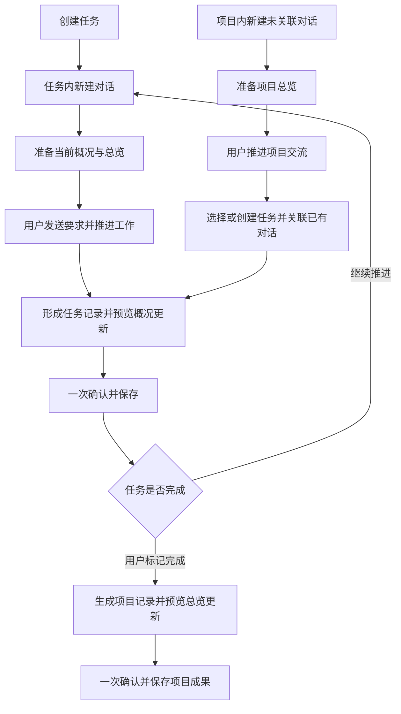

# AIKanBan：Deepseek Harness 桌面版看板功能 PRD

| 文档信息 | 内容 |
| --- | --- |
| 版本 | v1.17 |
| 日期 | 2026-10-14 |
| 状态 | 两轮评审已处理；运行中整理请求暂缓，项目备份暂不纳入首版，见第 17.4—17.5 节 |
| 产品范围 | 从零开发的 Deepseek Harness 桌面版中的项目看板与跨对话交接功能 |
| 主要用户 | 用 AI 对话持续完成本地项目的个人开发者及独立项目负责人 |
| 文档边界 | 定义功能、交互、业务规则、异常处理与验收；不指定技术架构、接口、框架或存储实现 |

> 阅读提示：第 1—7 章说明产品定位和主要体验，第 8—12 章定义详细功能，第 13—17 章定义范围、验收与实施约束。本文完整定义 AIKanBan 的产品行为，不以其他材料补充隐含功能。

### 需求阅读与实施规则

- 首版交付范围为 P0；P1、P2 是后续候选，不自动纳入首版。除明确标注优先级的条目外，详细功能要求均为 P0。
- 页面描述和流程图用于说明体验；状态、权限、确认、生效和异常恢复以详细功能规则为准。示意流程不能被解读为自动触发 AI 工作。
- 项目容器、对话、运行状态、模型设置等是本产品所需的桌面协作能力，不能仅凭本文使用这些概念就假定它们已实现。本文定义用户可见结果，不预设实现方式。
- 新建项目的看板初始为空。产品示例、验收数据和体验指标均不应作为默认任务、正式记录或已达成结果写入产品。
- 产品行为存在歧义时，应先核对本文相关功能和验收要求；不能自行增加自动执行、自动确认、跨项目共享或数据覆盖行为。
- 第 17.3 节允许调整呈现细节，不授权改变第 8—12 章的业务规则。
- 第 17.4—17.5 节列明交叉规则评审结果及暂缓边界。已确定部分按本文实施；明确不纳入首版的部分不开发、不作为验收依赖。
- 保存版本历史不等于将历史发送给 AI。默认上下文只使用当前正式概况与总览，历史正文须在明确追溯、比较或恢复时按指定范围读取。

## 1. 产品概述

### 1.1 一句话定位

**用任务组织多条 AI 对话，通过任务记录持续推进工作，并在任务完成后把成果沉淀为项目记录。**

AIKanBan 是 Deepseek Harness 桌面版的项目看板功能。一个项目拥有多个任务，也允许直接创建尚未关联任务的对话。一个任务下辖多条工作对话，这些对话可以串行接力或并行探索；任务对话可以在任务内新建，也可以由项目已有对话后续关联而来。看板表达用户决定的任务状态；对话推进阶段性工作；任务记录保存每条对话的工作；任务概况汇总当前可信状态；项目记录保存已完成任务的成果，项目总览提供项目共同背景。

用户没有打开任何对话时，也能创建任务、查看概况、手动修改内容和处理待确认更新。记录历史用于追溯，不自动成为每条新对话的全部上下文。

### 1.2 核心使用闭环

1. **创建任务。** 填写标题，任务目标与说明选填；任务默认未开始。
2. **在任务内新建对话。** 自动归属于该任务，跳转到对应对话；准备任务信息、当前任务概况和项目总览。
3. **推进本条对话的工作。** 用户输入本轮要求后执行；对话可以承担调研、实现或验证等阶段。
4. **点击“形成任务记录”。** AI 整理本条对话的工作，并提出任务概况更新；用户在同一个预览中修改、确认一次，保存记录并同步更新概况。
5. **在任务内新建下一条对话。** 自动读取最新正式概况；详细任务记录按需读取最新正式版本，不继承此前对话全文或历史版本。
6. **重复阶段性推进。** 多条对话共同完成任务；用户可以随时在 Trello 式看板中拖动卡片调整状态。
7. **标记任务完成。** 由用户拖入已完成列或明确设置状态；不强制所有对话均已结束或都形成记录。
8. **点击“生成项目记录”。** 根据该任务的正式概况与记录形成成果条目，并提出项目总览更新；用户预览并确认一次后保存。

同时支持“先对话、后任务”的入口：**项目内新建未关联对话 → 正常推进工作 → 在任务详情关联该已有对话，或在形成任务记录时选择/创建任务 → 审核精简结论 → 形成任务记录并更新概况 → 继续上述任务闭环。** 对话不要求创建时就有任务，关联本身不自动整理历史或开始新工作。

图示为典型主线，不是强制关卡：无记录也可开始；未记录完当前对话也可另开对话；完成某条对话不自动完成任务；完成任务不自动生成项目记录；同一任务允许多条对话同时推进。项目独立对话可以始终不关联任务，只有用户希望将相关工作纳入任务时才进入关联与记录路径。

### 1.3 产品目标

| 目标 | 用户价值 |
| --- | --- |
| 一项任务持续推进 | 多条对话共同围绕同一目标工作，成果不会散失 |
| 少重复整理 | 确认记录时同步更新概况或总览，不维护两套相同进展 |
| 用户掌握完成状态 | 看板可拖动，AI 运行与任务完成分别表达 |
| 项目成果可积累 | 每个已完成任务留下成果条目，项目总览持续反映有效背景 |
| 可信、可编辑 | AI 输出先为草稿；用户可修改记录、概况和总览 |
| 默认上下文精简 | 新对话只带当前必要内容，历史版本不默认发送 |
| 可恢复、可追溯 | 版本、来源和人工修改保留，失败不伪装成功 |

### 1.4 成功判断

用户能够用多条对话推进同一任务，通过已确认概况恢复工作，并在任务完成后形成可复用的项目成果；不需要复制此前对话全文，也不需要反复维护同一进展。保留更多版本历史，不应自动增加新对话默认携带的历史正文。

体验指标尚无实际使用基线，本文所列目标用于试用验收，不代表已达成结果。

## 2. 产品问题与解决方案

### 2.1 核心问题

真实工作往往跨越调研、实现、验证等多个阶段。任务卡片只能表达粗粒度状态，原始聊天又难以直接说明可信进展。用户需要在任务内组织多条对话，保留各阶段的成果，同时给下一条对话一个精简、准确的当前工作背景。

### 2.2 用户痛点与对应能力

| 问题 | 产品能力 |
| --- | --- |
| 多条对话成果分散 | 任务内对话列表与各自独立的任务记录 |
| 每次换对话都重新解释 | 自动准备任务概况和项目总览 |
| 后一条记录覆盖前一条成果 | 独立记录汇总为概况，保留来源，不按最后一条直接替换 |
| AI 摘要可能有错误 | 同次预览记录和汇总变化，允许编辑并明确确认 |
| 对话阶段结束被误认为任务完成 | 对话状态与看板任务状态独立 |
| 完成任务后成果未沉淀 | 任务内生成项目记录并更新项目总览 |
| 版本历史使上下文膨胀 | 当前内容默认读取，历史正文明确按需读取 |
| 中断后重复操作或丢输入 | 操作结果核对与草稿恢复 |

### 2.3 四类记录的职责

- **任务记录：** 对应一条对话在该任务中的工作，允许更新并保留版本。
- **任务当前概况：** 汇总整个任务当前有效的进展、决策、问题和下一步。
- **项目记录：** 对应一个已完成任务的成果条目，允许更新并保留版本。
- **项目当前总览：** 汇总项目目标、共同约定、有效成果、依赖和风险。

记录是可追溯的详细材料，概况与总览是日常推进的精简入口。二者不会通过未经确认的后台摘要独立改变。

### 2.4 新项目初始状态

看板、任务记录、项目记录、概况和总览初始为空；无预置对话、待确认草稿或正式示例数据。用户可先创建任务，也可手动填写项目总览中的目标与约定，不要求先完成所有分区。

## 3. 用户、场景与产品边界

### 3.1 主要用户

用 AI 推进本地项目的个人开发者与独立项目负责人，常将同一任务分布到多条对话中，希望控制任务状态、核对 AI 成果并保存可继续工作的背景。

### 3.2 典型场景

| 场景 | 需要的体验 |
| --- | --- |
| 新需求开始 | 创建任务后，在任务内新建对话 |
| 阶段交接 | 形成当前对话记录，下一条读取任务当前概况 |
| 并行探索 | 多条对话独立工作、独立整理，概况明确显示冲突 |
| 暂停后回来 | 先查看任务概况，再选择继续哪条对话 |
| 遇到阻塞 | 拖入阻塞列并说明原因，已有成果不丢失 |
| 任务完成 | 手动标记完成后生成项目记录 |
| 重新推进 | 保留此前成果，提示项目记录可能需要更新 |
| 项目启动 | 在无已完成任务时也能手动填写项目目标与规则 |
| 先交流后整理 | 项目内先开展未关联对话，之后关联已有任务或创建任务，纳入相关工作 |
| AI 不可用 | 任务管理、手动记录和查看历史仍可用 |

### 3.3 文档边界

本文定义看板、任务、对话归属、四类记录、版本、上下文使用与恢复体验。桌面通用聊天、模型设置、文件权限、终端等能力由其他功能定义；本文描述这些能力与任务的关系，不预设已经实现。

主要使用路径为多条对话前后接续推进任务，允许并行，但不要求用户管理并行分工。文件修改、并发写入和产物冲突由 Agent 与桌面工作能力处理；看板不新增文件锁、等待调度、差异合并或冲突处理界面。Agent 明确报告的冲突、失败、未验证情况须在记录中如实表达，不能整理为已完成且验证通过。

首版不包含多人协作、云端同步、排期工时、自定义复杂工作流或自动执行整个项目。

## 4. 产品原则与交互简化

### 4.1 核心原则

1. AI 形成的是草稿，用户确认后才成为正式记录、概况或总览。
2. 当前看板状态由用户决定，形成记录和 AI 响应结束都不自动完成任务。
3. 一次确认同时保存详细记录及对应汇总的实质变化，失败时不生效一半。
4. 各条对话的记录独立，不能用后确认的一条直接覆盖其他对话贡献。
5. 新对话准备背景后等待本轮要求；新建、关联和查看本身不执行工作。
6. 历史版本保留用于追溯，默认上下文只使用当前正式内容。
7. 人工修改有来源、有历史，后续 AI 汇总不得静默覆盖。
8. 没有记录不阻止开始工作，记录缺失不等于允许编造成果。
9. 对话首次关联后固定服务一个任务；关联不改写历史，管理数据删除不波及原始聊天和用户文件。

### 4.2 界面术语

| 用语 | 含义 |
| --- | --- |
| 任务 | 一件有目标和用户决定状态的工作 |
| 任务记录 | 某条对话在该任务中的阶段性工作记录 |
| 任务概况 | 整个任务当前有效状态的精简汇总 |
| 项目记录 | 某个已完成任务的成果条目 |
| 项目总览 | 项目共同背景与有效成果的精简汇总 |
| 待确认更新 | 尚未正式保存的记录及对应汇总变化 |
| 最新正式版本 | 最新保存的正式内容；其中关键结论是否仍适用，另按适用状态判断 |
| 结论适用性 | 当前适用、已被替代、已否定或待确认结论，附适用范围及已确认修正 |
| 历史版本 | 用于追溯、比较、恢复的此前正式内容 |

不要求用户在开始前学习版本机制。对话列表旁展示任务记录，项目成果列表展示项目记录；概况与总览作为默认阅读入口。

### 4.3 默认交互规则

| 编号 | 规则 |
| --- | --- |
| UX-01 | 标题即可创建任务，目标说明选填 |
| UX-02 | 任务详情固定提供“新建对话”，已有对话提供“继续对话” |
| UX-03 | 对话内点击“形成任务记录”，在原工作对话发送整理要求，同时生成记录与概况草稿，用户无需手动输入指令 |
| UX-04 | 记录和概况在同一预览中确认，不要求分别确认两次 |
| UX-05 | 已完成任务点击“生成项目记录”，系统自动创建整理对话，同时预览项目总览变化，可查看整理过程 |
| UX-06 | 看板默认四列，已取消收起；支持拖拽与菜单等效操作 |
| UX-07 | 卡片进展来自任务概况，不来自最后一条对话记录或草稿 |
| UX-08 | 详情按需展开记录全文、来源及历史，不把所有版本铺满页面 |
| UX-09 | 概况、总览可直接手动编辑；不另设相同进展的第二份表单 |
| UX-10 | 多条对话可以各自整理，不因另一条对话有草稿而禁用全部入口 |
| UX-11 | 缺少记录、存在未确认内容时给出范围提示，不强制先整理完才新建对话 |
| UX-12 | 完成任务前不强制所有对话停止；生成项目记录前显示遗漏与仍在运行的工作 |
| UX-13 | 新对话不复制此前聊天，不默认加入历史版本；详细记录仅按需读当前版本 |
| UX-14 | 普通保存一次确认；永久删除明确展示影响 |
| UX-15 | 项目内可直接新建未关联对话；任务详情提供“关联已有对话”，无需重建聊天 |
| UX-16 | 未关联对话点击“形成任务记录”时先选择/创建任务，再审核记录草稿；取消不产生虚构记录 |

### 4.4 主要动作

- **新建对话：** 在当前任务下创建并打开独立对话，准备当前背景，等待用户发送要求。
- **项目内新建对话：** 创建未关联任务的独立对话，只准备项目总览，任务选择不是必填步骤。
- **关联已有对话：** 在任务内选择同项目对话，建立归属；用户之后点击“形成任务记录”时，才根据整条对话提炼相关结论，审核确认后保存。关联本身不发起整理。
- **继续对话：** 打开用户选择或最近使用的对话，不自动发送继续指令。
- **形成任务记录：** 整理指定对话的工作，并预览任务概况变化。
- **生成项目记录：** 已完成任务形成项目成果条目，并预览项目总览变化。

“编辑任务概况”“编辑项目总览”“查看历史”是辅助动作，不另建虚构任务或对话。

## 5. 信息架构与页面职责

### 5.1 产品结构

项目 → 看板 → 任务详情 → 该任务的多条对话与任务记录。

项目 → 项目对话列表 → 可独立工作的未关联对话，以及已有任务归属的对话。

项目 → 项目总览 → 各已完成任务的项目记录。

项目 → 待确认 → 记录与对应汇总的待确认更新。

项目 → 更多 → 归档、偏好。

### 5.2 看板

| 区域 | 默认内容 |
| --- | --- |
| 项目栏 | 项目名、项目总览、待确认数量、新建任务 |
| 工具栏 | 搜索、状态及待处理筛选、清除筛选、排序 |
| 主体 | 未开始、进行中、已阻塞、已完成四列；已取消按需展开 |
| 卡片 | 标题、一行任务概况进展或目标、阻塞原因、需要用户处理的提示 |

任务完成而尚未生成项目记录时提供“待生成项目记录”提示；此提示不是未确认草稿，不混入待确认数量。已生成但来源变化时显示“项目记录待更新”。

### 5.3 任务详情

默认在看板旁打开，空间不足时全页呈现；返回保留筛选和定位。

1. 标题、目标、任务状态与“新建对话”“关联已有对话”。
2. 当前任务概况：整体进展、有效决策、问题及下一步，提供编辑入口。
3. 当前对话列表：标题、运行情况、最近工作、任务记录是否已形成，以及继续/形成记录入口。
4. 各条对话的当前任务记录：默认摘要与来源，全文和版本历史展开查看。
5. 当前待确认更新：按来源对话区分，每次预览记录和概况变化。
6. 已完成任务的项目记录入口；已有成果显示是否需要更新。

历史参与对话折叠。归档、取消与永久删除放入更多操作。

### 5.4 对话中的任务侧栏

显示归属任务、手动任务状态、当前概况、此次实际使用的背景版本与范围；归属任务仍存在时提供“形成任务记录”“返回任务”；来源任务已删除时按 FR-07 展示禁用记录入口及“返回项目”。本条对话已有记录时显示当前版本及“有新内容待整理”的实际提示。

未关联对话显示“未关联任务”、当前项目和项目总览使用情况，提供“关联任务”“形成任务记录”“返回项目”；不展示虚构的任务状态或概况。“形成任务记录”先进入选择/创建任务流程，关联后继续核对来源并生成。

生成按钮作用于当前对话在当前任务中的工作，不自动读取其他任务的聊天。执行权限审批与记录确认分别命名。返回任务后可直接新建下一条对话。

### 5.5 集中待确认

按“任务记录更新”“项目记录更新”“手动概况/总览草稿”分类。每条记录及其汇总变化是一个确认项；不能把两个部分计数两次。显示任务、来源对话或成果任务、生成时间、变化摘要及需核对原因。

### 5.6 项目总览与成果列表

默认展示当前项目总览，提供“编辑总览”。下方展示各已完成任务的当前项目记录、任务来源和是否待更新；可查看历史而不铺开全部正文。

生成界面提供“查看整理对话”，任务记录草稿可返回对应工作对话查看过程。“生成项目记录”的主要入口在已完成任务中；成果列表可以跳回该任务或对已有条目发起更新。项目目标与共享规则可在首个任务完成前手动填写。

### 5.7 项目对话列表与任务候选

项目对话列表支持独立新建、查看和打开对话，展示“未关联任务”或当前任务名称，可按全部/未关联/已关联筛选及按标题搜索。未关联是对话归属状态，不是看板任务状态。来源任务已删除的对话显示“来源任务已删除”及保留的原任务名称，不变为未关联；在“全部”和“已关联”中可见，不新增专门筛选。

任务详情中的“关联已有对话”打开当前项目候选：默认优先展示未关联对话，可查看已有归属；已属于当前任务的显示已关联，属于其他任务的不可关联，不提供转移或改绑。不可打开的历史来源不作为无提示可关联候选。

## 6. 核心对象与业务状态

### 6.1 对象关系

| 对象 | 范围与规则 |
| --- | --- |
| 项目 | 拥有多个任务、项目内对话、一份当前项目总览和多个任务成果条目；对话不必先属于任务 |
| 任务 | 只属于一个项目，拥有多条对话、一份当前任务概况 |
| 工作对话 | 属于一个项目，任务归属在首次关联前可以为空；关联后固定服务该项目的一项任务，不支持跨任务转移、改绑或解除后再绑定其他任务 |
| 系统整理对话 | 项目内生成项目记录或更新项目总览建议的执行载体，关联一次整理及其来源任务；不作为工作对话计入任务列表，不参与工作对话绑定，不生成自己的任务记录 |
| 任务记录 | 对应该对话在指定任务中的工作；每个对应关系一份最新正式记录，更新保留历史 |
| 任务概况 | 汇总该任务当前适用的已确认结论、仍有效成果和用户修正，不按最后一条记录全文替换 |
| 项目记录 | 对应一个已完成任务；每任务一份当前有效成果条目，更新保留历史 |
| 项目总览 | 汇总项目共同信息、有效成果及用户修正，不逐条追加全部成果全文 |
| 待确认更新 | 某条记录及对应概况/总览的候选变化；或用户手动编辑的草稿 |
| 已确认版本 | 不可原地覆盖的正式内容，保留时间、来源与前后关系 |
| 本次要求 | 本轮工作要求，不自动变成长期记录 |

没有对话的任务可以手动编辑概况，不制造虚构对话记录。项目总览可以独立初始化，不要求先完成任务。工作对话只能服务一个任务；任务记录始终属于该任务，不因任务归档或删除转给其他任务。

未关联对话可正常输入、执行、暂停和继续。没有任务归属时，不创建任务记录、不更新某项任务概况，也不将该对话直接当作已完成任务的项目成果。后续关联不会重写已有消息或自动确认其中的结论。

### 6.2 任务状态

| 状态 | 含义与规则 |
| --- | --- |
| 未开始 | 默认状态；创建或打开对话不自动修改 |
| 进行中 | 用户决定正在推进 |
| 已阻塞 | 原因必填；可以继续调查或另开对话，不等于所有工作停止 |
| 已完成 | 用户认为任务目标已达成；不强制对话全部结束或记录齐全 |
| 已取消 | 用户决定不再推进；保留全部历史 |

状态可以由用户拖动或菜单调整。AI 响应完成、记录保存或项目记录生成均不自动改变状态。已完成/已取消可重新打开。归档控制可见性，不是额外状态。

### 6.3 对话运行状态

支持可输入、正在处理、等待回答、等待具体执行确认、本轮结束、正在停止、已停止、失败、需要核对。状态必须有实际结果依据；“已打开”不等于正在执行，“本轮结束”不等于任务完成。

形成任务记录不关闭对话，不禁止继续工作。暂停或完成任务不自动停止所有对话。

### 6.4 更新与并行状态

记录更新支持整理中、待确认、需要核对、已确认、已放弃、整理失败/已取消。只有确认保存成功才用于正式上下文。

- 每条对话在本任务中的任务记录最多一份活动草稿；不同对话可同时整理。
- 每个任务的项目记录最多一份活动草稿；不同任务可同时准备项目成果。
- 手动编辑概况/总览的草稿独立保存，不能覆盖记录草稿；同一对象的竞争修改在确认时核对当前版本。
- 其他对话更新概况，或其他任务更新总览，不直接作废本条记录的独立事实草稿；仅重新核对受影响的汇总部分。
- 整理失败或中断不能永久占住入口；保留输入并允许重试。

### 6.5 背景使用与来源有效性

对话背景使用状态区分未准备、准备中、已准备待发送、已用于本轮、有更新可用、准备失败、结果待核对。只有内容实际提供给本轮工作才登记使用范围，关联和预览不算。

项目记录另有来源提示：当前来源一致、源任务重新打开、源任务记录/概况已更新、来源不可核对。提示不删除正式历史；用于说明成果截止范围及是否需要重新生成。

## 7. 主要用户流程

### 7.1 创建任务与首次对话

创建标题必填、说明选填的任务 → 打开任务详情 → 点击“新建对话” → 自动归属并跳转 → 准备当前任务信息、概况和项目总览 → 用户发送本次要求。

没有概况或总览时显示暂无，但可以正常工作；不要求再填写相同任务目标。用户希望任务进入进行中时，主动拖动或设置状态。

### 7.2 形成任务记录

完成一段对话工作后点击“形成任务记录” → 确认当前对话 → AI 提炼精简记录与概况变化 → 同屏预览并编辑 → 用户确认一次 → 对应记录与概况的变化正式生效。

默认保留本条记录仍有效内容，只更新新增、变更或明确删除的事实。任务概况保留其他对话贡献和人工修正，不自行改变看板状态。

### 7.3 新建下一条对话或并行对话

回到任务 → 点击“新建对话” → 创建独立对话 → 默认准备当前任务信息、最新正式概况与总览 → 用户指定本轮工作。

不要求上一条对话先结束或记录完；缺失工作显示提示，默认不会把未确认结论带入。详细记录按需读取最新正式版本，历史版本和原始聊天不默认携带。

### 7.4 继续已有对话

选择对应对话并打开，不自动发送消息。当前背景发生变化时提示“背景有更新，下次发送时自动同步”；用户发送新要求时自动检查并补充，不需额外点击更新。相同版本不重复追加全文，正在执行的工作不被中途替换。

### 7.5 完成任务与生成项目记录

用户将任务拖入已完成列 → 任务显示“生成项目记录” → 列出仍在运行对话、未形成记录工作及本次来源范围 → 用户选择补齐或按现有正式内容继续 → AI 生成成果条目与总览变化 → 同屏预览 → 确认一次保存。

现有记录不完整时，不推断缺失部分已经完成。任务完成状态与项目记录是否生成分别表达。

### 7.6 手动修正与任务重新打开

用户可直接编辑任务概况、项目总览及已有记录，预览变化后保存版本；不回写原始聊天或篡改其他记录。后续 AI 更新保留人工修正，实质冲突由用户核对。

任务重新打开时保留此前项目成果，标明对应前一次完成。记录或概况变更后提示成果待更新；再次完成后更新同一任务的当前项目记录，保留历史，不重复算作新任务成果。

### 7.7 项目先开展对话，再关联任务

1. 用户在项目内新建对话，不选择任务；默认只准备项目总览，输入本轮要求后正常工作。
2. 用户在任务详情点击“关联已有对话”，搜索并选择同项目对话；也可从未关联对话点击“关联任务”。
3. 未关联对话直接建立归属；已有其他任务归属的不可关联。关联不复制或重写聊天，不自动改任务状态。
4. 关联后提示任务背景将在下一次发送时自动准备并使用；不会声称已经用于此前工作，也不打断当前执行。
5. 首次形成任务记录时根据整条对话提炼与任务相关的有效结论；不要求用户选择消息范围，用户直接审核并编辑记录草稿。
6. 用户预览并确认记录与概况后，工作进入正常任务闭环，不必重建对话。

未关联对话直接点击“形成任务记录”时：选择当前项目已有任务或创建任务 → 关联 → 根据整条对话生成精简记录 → 预览、编辑并确认。任务选择取消后仍未关联；关联已经成功后取消整理，保留明确完成的关联，但不生成正式记录。

### 7.8 日常保存与中断恢复

任务与正式记录按正常操作保存，编辑草稿按 FR-28 保留；异常中断后核对结果、恢复可用草稿，不自动重放工作。项目数据导出备份及备份恢复暂不纳入首版。

## 8. 详细功能：项目与任务管理

P0 为首版必须具备；P1/P2 为后续候选。以下未单独标注的规则均为 P0。

### FR-01 项目看板与项目隔离

- 项目内直接打开看板，无对话也可管理任务。
- 项目名称始终可见，同名项目提供位置等辨识信息。
- 切换项目时，任务、记录、概况、总览、待确认与归档列表一起切换。
- 搜索、筛选、排序和详情定位按项目分别保留。
- 新建任务自动归属当前项目；记录及汇总不默认跨项目共享。
- 工作范围不可用时保留管理数据；依赖文件的对话工作提示补充范围，不猜测其他项目。
- 更改项目位置不自动改变已有对话的工作范围，不移动或删除代码文件。

**验收：** 两个项目的管理与确认互不串入；关闭全部对话后仍可打开看板。

### FR-02 快速创建任务

- 只要求标题，任务目标说明选填；空白标题就地提示。
- 未填写说明时，用户标题作为最简目标，不虚构详细需求。
- 默认未开始；列内添加可采用对应状态，阻塞列原因必填。
- 创建不调用 AI、不创建对话、不生成正式记录或概况版本。
- 同名任务允许存在，不自动合并；同一次提交连点或重试不得重复创建。
- 成功后可直接打开详情；失败保留输入。
- 多行批量创建为 P1，自动拆解模糊项目目标为 P2。

**验收：** 标题即可创建，AI 不可用仍可建卡；重复点击只形成一个任务。

### FR-03 任务信息与当前概况

| 信息 | 来源与编辑规则 |
| --- | --- |
| 标题、目标说明 | 用户直接编辑；说明选填 |
| 看板状态 | 用户拖动、菜单或明确管理指令决定 |
| 阻塞原因 | 阻塞时必填，由用户决定 |
| 整体进展、有效决策、问题、下一步 | 来自当前正式任务概况，可手动编辑 |
| 对话任务记录 | 各对话独立保存，用作概况来源，不直接作为整项任务的唯一摘要 |
| 更新时间与来源版本 | 显示实质内容变化，不把打开页面算作更新 |

- “修改进展/下一步”进入任务概况编辑，允许直接修改对应内容，不要求先改某条对话记录。
- 保存人工概况修正形成版本，标注用户来源，不回写或改造对话记录。
- 形成任务记录时，AI 基于当前概况和相关正式来源提出更新，保留有效人工修正；冲突明确显示。
- 最后确认的对话记录不能整段替换概况，其他对话成果仍需保留。
- 无概况时显示暂无；有已保存记录而概况暂不可核对时，明确提示并允许查看记录，不用未确认摘要冒充正式概况。
- 任务目标在概况确认后改变时，提示核对适用范围；交接时当前目标独立可见，不被历史记录覆盖。
- 编辑离开页面应保留草稿或提示处理；保存失败保留输入。
- 活动历史可查状态、目标、归属与确认等重要变化，不要求保存每次键入。

**验收：** A、B 两条对话的有效成果均可汇总；手动修正不被后续整理静默覆盖；状态不随概况保存改变。

### FR-04 拖拽状态与任务完成

- 支持列间拖拽与菜单，键盘无需拖拽也可调整状态；同列拖动调整顺序。
- 拖入阻塞列，无原因时就地填写，确认后生效；取消留在原列。
- 从阻塞恢复时解除当前阻塞提示，此前原因保留活动历史。
- 拖入已完成列不强制所有对话结束或记录齐全，显示仍在运行、存在未记录工作的提示，不偷偷停止工作。
- 完成状态不自动生成项目记录；任务显示可生成入口及未生成提示。
- 已完成/已取消可重新打开。重新打开保留记录，已存在项目成果注明前一次完成范围。
- 普通流转提供撤销；后续已有新修改时不通过撤销覆盖它。
- AI 本轮结束、记录确认和项目记录保存均不自动改状态；用户明确要求指定变化可执行并报告结果。
- 保存失败保持正式原状态，不把未保存状态当作事实。

**验收：** 用户可在有未记录对话时标记完成；AI 结束不自动完成任务；完成和项目记录生成是两个动作。

### FR-05 卡片与行动提示

- 默认显示标题、一行任务概况进展；无概况时显示目标。
- 阻塞原因文字可见，不只靠颜色表示。
- 对话运行、等待用户处理、待确认记录、背景准备失败按真实情况展示，同类提示汇总。
- 多对话运行时显示数量并可选择目标；新建对话仍可用，不因已有工作而强制串行。
- 卡片打开任务详情，详情固定提供新建对话；每条已有对话提供继续与形成记录。
- 已完成任务明确区分项目记录未生成、已生成和待更新，不等同于任务未完成。
- 已取消默认收起，已完成不自动归档；历史版本数和完整记录在详情按需查看。

**验收：** 卡片不采用草稿或最后一条记录冒充整体进展；项目记录提示与状态含义不混淆。

### FR-06 搜索、筛选与排序

- 当前项目搜索覆盖任务标题、目标、概况、各对话当前正式记录及阻塞原因。
- 历史版本正文不默认纳入当前任务搜索；明确查看历史不自动给 AI 投递搜索命中全文。
- 最新正式记录中若命中已被替代、已否定或待确认结论的片段，结果必须显示状态、适用范围及已确认修正，不能仅展示原句让其看起来仍是当前事实。
- 默认活动任务，可选择包含归档，归档命中标记清楚。
- 支持任务状态、待确认、阻塞、等待用户处理、项目记录待生成/待更新筛选。
- 同类别多值任选其一，不同类别共同满足；显示筛选与清除入口。
- 列头显示匹配/总数量，区分无任务与无筛选结果。
- 默认手动排序，可按最近更新；自动排序模式不同时承诺拖动保存手动顺序。
- 跨项目统一搜索及列表视图为 P1。

**验收：** 能找到当前记录中的关键词；历史内容不无标识混入当前结果；筛选可清除。

### FR-07 归档、恢复与永久删除

- 归档只隐藏活动任务，保留所有记录、概况、来源、版本和对话关系，不改状态、不停止 AI。
- 运行中归档提示工作仍继续；恢复返回原状态，排序位置不可用时放列末尾。
- 归档任务可查看与搜索，新建工作、整理或确认记录前先恢复；已有整理可以完成为草稿，不自动确认。
- 归档不删除已生成项目记录，也不把项目总览成果自动移除。
- 永久删除仅对已归档任务提供，列出任务字段、概况、对话任务记录、草稿与关系等影响范围并二次确认。
- 对话仍在运行时先结束当前工作再永久删除任务；删除不等于停止，也不释放对话用于其他任务。
- 已经进入项目的成果记录保留，来源标记任务已删除；不把删除管理卡片当作撤销已确认项目成果。确认界面明确该范围。
- 对话原文与代码文件不连带删除。任务删除后其记录不再作为可打开的来源，项目成果保留已确认内容和必要的来源标识，不指向同名新任务。
- 永久删除不可撤销，确认前明确提示；普通归档与取消归档提供撤销。

#### 来源任务已删除的工作对话

- 保留原对话与原任务名称/来源标识，显示“来源任务已删除”；仍可查看并继续聊天，不再读取已删除任务概况或记录。已有聊天内容不能宣称已清除，新背景仅可按项目范围准备，不能伪造任务。
- “形成任务记录”禁用，就地说明“来源任务已删除，无法形成任务记录”；“返回任务”替换为“返回项目”，不链接不存在的任务。
- 不显示“有新内容待整理”或为该任务新增整理请求、草稿及待确认提示；不使对话成为未关联候选，不能改绑其他任务，重启后保持该状态。
- 永久删除确认同时说明“对话保留，但无法继续形成该任务记录，也不能改绑”，纳入已有删除确认，不增加额外弹窗。

**验收：** 归档恢复后内容一致；删除不波及原始聊天/代码，已有项目成果不会被无提示删除或认成另一任务来源。

## 9. 详细功能：对话归属与阶段推进

### FR-08 项目与任务内新建对话

**项目入口：**

- 项目对话列表可直接新建独立对话，当前任务归属为空，不强制选择、创建或虚构任务。
- 默认准备当前项目与工作范围、当前正式项目总览，不读取任何任务概况、任务记录或所有任务全文。
- 未关联对话正常支持发送、运行、停止和继续；无总览时仍可工作。
- 不自动采用最近使用任务作为归属，不因用户曾打开某卡片而隐式绑定。

**任务入口：**

- 任务详情固定提供“新建对话”，第一次与后续使用同一动作；就地简短提示“此对话固定属于当前任务”，不增加额外确认弹窗。
- 创建独立对话、归属指定任务、准备背景并跳转；不复制另一条对话的完整消息历史，不要求手工绑定。
- 项目范围继承当前任务，任务标题用于初始命名参考；名称与桌面对话一致。
- 默认背景为任务信息、当前正式概况、当前正式项目总览，空内容不妨碍开始。
- 同次操作重复点击只创建一条；用户再次主动发起才视为下一条对话。
- 创建、归属、准备分别显示实际结果。失败重试只补失败步骤，保留已经创建的对话和用户输入。
- 准备未完成时发送，应等待或明确选择暂不带背景，不能静默漏掉内容。
- 不自动执行，用户发送本次要求后开始；已有对话运行或尚无记录不阻止并行新建。

**两种入口共同规则：** 独立创建并打开，不复制其他对话全文，不自动执行，同次重复提交不重复创建；失败保留输入和已成功步骤。项目入口没有任务归属是正常结果，不应被报为绑定失败。

**验收：** 项目入口可无任务独立工作，任务入口自动归属并跳转；无用户发送不执行，重试不重复创建。

### FR-09 继续指定对话

- 用户可以选择任一可用当前对话；快捷继续默认打开最近实际使用的对话，可改选。
- 项目列表中的未关联对话同样可继续；提示项目总览更新，下一次用户发送时自动同步；不要求先选任务或显示虚构任务概况。
- 打开不发继续指令，不更改状态或生成记录；正在运行时跳到实际工作。
- 当前概况/总览有更新时提示下一次发送自动同步；发送前检查并补充，记录实际提供版本，不要求额外选择更新。
- 相同内容不重复追加全文；无法打开时保留来源，并提供在任务内新建对话。
- 形成任务记录后仍可继续原对话，新工作可再次整理更新同一最新正式记录。

**验收：** 重开对话不产生新消息；阶段记录不封闭对话；新工作后能更新记录并保留此前版本。

### FR-10 关联已有对话与固定归属

- 任务详情提供“关联已有对话”；未关联对话提供“关联任务”，操作同一归属关系。
- 候选仅限当前项目可用且未绑定任务的对话，支持搜索，显示真实标题和运行状态；其他任务的对话不能作为可选项。
- 一项任务可关联多条对话，一条对话只服务一项任务。首次关联前可以为空，关联后固定归属，不提供解除、改绑或跨任务转移。
- 绑定前明确展示所选目标任务名称，并在“关联”按钮旁就地提示：“关联后不可解除或改绑。即使任务被删除，此对话也不能关联其他任务。”点击关联即完成，不增加额外确认弹窗；已关联本任务不重复添加。需推进另一项任务时新建对话。
- 归档目标需先恢复；其他项目或已删除任务不能作为新关联目标。删除任务保留原对话的来源标识，不使其变为其他任务的可关联对话。
- 关联不复制、改写或清空消息，不改任务状态，不生成正式记录或自动开始工作。
- 运行中的未关联对话可建立归属，不打断当前工作；任务背景按 FR-22 在用户下一次发送要求时自动提供，不在本轮结束时自行发起执行。
- 首次形成记录根据整条对话提炼与任务相关的结论，用户审核草稿；关联本身不确认此前成果，不要求选择关联前后消息范围。

**验收：** 未关联对话可搜索并绑定一个任务；已绑定对话不能再关联其他任务；关联不改写历史、不启动工作、不确认成果。

### FR-11 对话列表与记录来源

- 当前对话默认展示，历史参与折叠；点击行打开对话，不先跳额外管理页面。
- 行中显示真实标题、工作状态、最近阶段、是否有任务记录及最近成功整理处理位置。
- 有记录的对话在上次成功整理处理位置后出现新增交流，本轮结束时提示“有新内容待整理”；仅判断是否有新内容，不判断其价值或工作是否成功。整理指令及整理回复不触发该提示。首次尚无记录时展示“尚未形成任务记录”。
- 标题同步桌面命名，不另设看板昵称；同名对话用时间和简短信息区分。
- 来源详情展示该任务中的有效记录、实际背景使用及历史版本；不要求每句话逐条引用消息。
- 来源不可打开时保留标识、记录与概况贡献，不把其成果清空。

**验收：** 每条对话对应自身任务记录，覆盖时间清楚；来源消失不导致已确认成果丢失。

### FR-12 并行推进与冲突

- 同一任务可同时运行多条对话，每条工作和记录草稿独立。
- 未结束或未确认工作不默认成为另一条对话的事实背景；可以显示有并行工作尚未记录。
- 不同对话形成记录不能因同任务已有草稿而被全局禁用。
- 确认 B 的记录时保留 A 的有效贡献与人工概况修正，不按确认时间自动判定全部 B 内容胜出。
- 互相矛盾的方案或验证结果在概况预览中提示，用户可裁定或明确保留待决定状态；不要求为了保存独立记录先消除所有讨论分歧。
- 确认仍以一致的记录和概况结果为一次操作；不可半保存。
- 停止一条不停止其他，状态完成/取消不自动停止工作；停止全部为 P1。

**验收：** A、B 能各自整理；确认后的概况保留有效成果、显示冲突，不隐式选胜者或改变状态。

## 10. 详细功能：任务记录、概况、确认与上下文

### FR-13 任务记录与概况的内容

**任务记录**是一条对话为其唯一归属任务提供的精简结论，按以下六类组织；无实质内容的分区省略，不生成占位文案：

| 分区 | 内容要求 |
| --- | --- |
| 本阶段目标与范围 | 本条对话承担的工作，不自行扩大任务目标 |
| 决策与约束 | 最终有效决策与必要约束；未定事项放入问题，不罗列未选方案 |
| 已完成工作与阶段进展 | 真实做过的工作，不把计划写成完成 |
| 产物与验证 | 产物位置、实际验证及结果，不虚构文件或未执行测试 |
| 问题、阻塞与风险 | 未解决事项、冲突和不确定性 |
| 后续建议 | 本阶段之后可做的事，不等于已经授权执行 |

- 同一对话在本任务中一份最新正式记录，可以多次更新，每次实质确认保留版本。
- 再次整理保留本条对话仍有效的此前成果，更新整理截止时间；不无限重复追加相同内容。
- 记录是阶段成果，不是全文聊天、完整日志或大段代码。

#### 任务记录的精简与质量规范

- 只保留后续对话继续工作或判断任务完成所需的信息：有效结论、真实成果、关键产物与验证、未解决问题、必要下一步。
- 一条要点表达一个结论或行动，使用直接、具体的短句；相同事实只出现一次，不在多个分区重复。目标只用一句概括本对话贡献，不复述完整任务描述。
- 省略问答过程、礼貌套话、AI 自述、重复背景、操作流水、长日志、大段代码、已解决问题以及不影响后续工作的失败尝试和候选方案。
- 被放弃方案仅在防止重复走错路时保留一句原因；后续修正取代此前结论，保留必要的适用状态与修正提示，不拼接历次记录正文。
- 产物用可定位的名称或位置加实际结果；验证结论必须说明验证对象、关键范围及通过/未通过/未验证。不能把“已生成”“已修改”写成“已验证”。详细证据优先链接来源或产物，不复制进记录。
- 不确定内容明确为待确认，不为了填满模板生成事实、风险或下一步。用户意图、执行结果和 AI 建议清楚区分；建议不等于已授权工作。
- 各分区通常保留 1—3 条必要要点；无新增实质成果时明确提示，不为凑字数生成新版本。该数量是精简目标，不是强制截断上限，关键约束、风险和验证边界不得丢失。
- 用户可直接编辑草稿；保存前不自动重新压缩或改写用户编辑。人工删除的无关内容和明确纠正应在再次整理时遵守；对话中新出现实质变化时可提出更新，不能反复恢复此前被删的同一噪音。
- 同一规范适用于任务概况的压缩，但概况汇总多条对话的当前有效贡献，不简单拼接记录。

**任务概况**汇总整个任务当前有效信息：整体进展、有效决策与约束、关键成果索引、未解决问题、下一步。 一项任务有多份对话任务记录，但只有一份当前正式概况。记录保留各条对话的贡献，概况依据已确认记录和用户修正表达当前全局情况；后续阶段进展可取代概况中的早期状态，不拼接所有记录，也不将阶段事实误判为当时错误。新对话默认读概况，需要细节时才读相关记录。任务标题/目标/看板状态由任务字段提供，不在概况中维护第二份可独立覆盖的状态。

- 概况以已确认任务记录和用户明确修正为事实来源，保持精简。
- 相同事实可合并表达，重要约束和风险不得因压缩静默丢失；详细证据留在当前记录中。
- 不把最后一个确认记录当作全部任务成果，也不全文拼接全部记录。
- 互相矛盾的结论注明来源，保留为待决定或由用户明确裁定。
- 用户修正概况可以否定某条记录对“当前任务”的适用性，记录仍作为阶段历史保留；不必改写原始聊天。

#### 记录版本与关键结论的当前适用性

版本表示保存历史，结论适用性表示当前能否作为工作依据。最新正式版本中也可能含已被替代的阶段决策；不能仅因它是最新版，就将全部正文当作当前事实。

只对影响工作的关键决策、约束、验证结论及其对应内容片段标注，不要求逐句审批整篇记录。一条记录中的某个结论失效，不自动废弃其他成果。

| 适用状态 | 含义 | 当前工作使用规则 |
| --- | --- | --- |
| 当前适用 | 已确认，在明确范围内仍有效 | 可作为该范围的依据，验证结果不得扩展到未验证方案/产物 |
| 已被替代 | 后续已确认结论取代它 | 使用替代结论，旧结论只作带说明的阶段背景 |
| 已否定 | 用户明确认为错误或不再适用 | 不作为当前事实，附修正说明与依据 |
| 待确认结论 | 存在矛盾或适用性尚不确定 | 可作为未决问题正式保存，不作为确定依据；不因此阻止成对保存 |

- 保留记录原文与版本，在读取时附当前适用状态、范围、修正来源和替代内容；不篡改原始聊天或把历史改写成当时已知修正。
- 用户在概况/总览明确改变结论时，指出受影响的来源片段，用户核对后同次确认生效。不能只保存概况纠正文案，却继续无标注返回已否定片段。
- 删除摘要、缩短表达、未选入某次汇总，不自动等于否定来源结论；否定与替代须有明确含义及确认。
- AI 可提出关联、替代或核对建议，不能自行裁定否定或替代。无法确定匹配或影响的内容明确需核对，不继续冒充确定事实；核对交互按 FR-16 执行。
- 修正范围明确到当前任务或项目共同规则；本任务否定 A 不因文本相同就使其他任务的 A 作废。
- 同范围内引用该片段的记录、概况、总览、搜索结果与生成材料，必须同时体现已确认修正；不能等项目成果重新生成才阻止旧结论作为当前事实读取。
- 历史正文、修正和适用状态可一起追溯，默认背景仅包含当前适用内容及必要的简短修正提示，不额外注入全部纠正历史。
- 例：阶段记录写“采用 A；A 的验证已完成”，后续明确改用 B。当前读取表达“现采用 B；A 已被替代。A 的验证是此前成果，不能证明 B 已验证”。

**验收：** 各对话记录独立，概况体现多方有效贡献；失效片段不作为当前事实重新出现，同条记录的其他适用成果保留。

### FR-14 形成任务记录与同步概况

- 对话侧栏按钮作用于当前归属任务和当前对话；任务详情按对话行触发，不用无关当前页面会话作为来源。
- 点击“形成任务记录”即授权本次整理，系统在对应工作对话中发送可见的整理要求，无需用户再输入或发送一次指令。示例：“整理本条对话的任务成果并提出任务概况更新，仅生成待审核草稿，不继续执行工作。”
- 该工作对话中的 Agent 先依据本条已结束工作、已有任务记录与人工修正生成记录草稿，再依据当前任务概况与本次记录草稿提出概况更新；必要时按 FR-21 读取相关正式记录，不加载其他对话原文或全部历史。
- 任务概况没有固定负责对话；每次形成记录的工作对话提出此次更新，必须保留其他对话有效贡献，不能以当前对话的局部认识替代整个任务情况。
- 本阶段按用户在相关对话工作均结束后点击整理的正常路径设计。运行中提前点击后的等待请求、停止、失败、审批及重启调度暂不规定，见第 17.5 节；不将队列功能作为首版验收要求。实际发送仍须核对归属及来源，不投递到其他对话。
- 本次整理以发送整理要求前的已结束工作为截止；整理指令、生成草稿、旧整理回复和未确认候选不作为新工作成果反复汇入记录。再次整理仍可参考完整实际工作内容、已确认记录及用户修正，不让整理消息产生自我重复。
- Agent 返回任务记录和概况候选后，界面同屏呈现可编辑草稿与差异；普通聊天回复或“整理完成”提示不等于正式保存，必须由用户一次确认。

- 未关联对话点击“形成任务记录”先选择当前项目已有任务或创建任务，成功关联后继续同一整理意图，不要求重新开对话。
- 任务选择取消且尚未关联时保持未关联，不建立记录或整理草稿；已创建任务但关联失败时保留该任务，重试关联同一目标，不重复创建。已经关联成功再取消整理，只取消整理，不自动撤销明确完成的归属。
- 显示本条对话名称、整理截止时间、最新正式记录和概况基线，无消息区间选择器。
- 首次与再次整理均以整条对话截至本次整理时的已结束内容为依据，提炼与当前任务相关的有效结论；参考已有记录与已确认人工修正，不按单一消息截止位置决定遗漏或补录。
- 首次关联前的相关内容同样可以提炼；无关内容不进入记录，用户直接在草稿中删除或修正，无需标记消息为未选择、待补录或排除。
- 一条对话只有一份任务记录；继续原对话后再次形成记录更新同一份内容，不追加重复记录。放弃草稿不改变正式记录，重新整理仍可参考全部已结束内容。
- 正常路径在工作结束后整理，不要求手动选择消息片段，不把未结束或未验证结果写成完成；暂缓边界不构成全项目对话必须同时结束的额外强制关卡。
- AI 首先形成该对话记录的候选更新，然后基于当前概况、候选记录和必要的其他当前正式来源提出概况变化。
- 其他对话记录只在判断相关事实时按需读最新正式版本，不默认读取其全部历史版本或原始聊天。
- 保留其他对话贡献及人工修正；修改本条记录使某项事实失效时，核对概况中的相应来源，不把无关成果删除。
- 同屏展示“本条任务记录变化”和“任务概况变化”，允许用户编辑；一次确认完成保存。
- 用户拒绝某项记录变化后，概况预览同步核对，不能把被拒绝的候选当成事实。
- 任务记录及任务概况更新在原工作对话执行，不要求用户另建整理对话；项目成果使用 FR-25 的系统整理对话。整理后不自动接续开发任务。
- 无对话或不可读来源时，可手动补概况；不能创建虚构来源记录或声称完成了无法读取的整理。

**验收：** 每条对话只更新自身记录并同步概况；正常操作无需范围选择；再次整理形成精简完整结论，保留其他对话贡献与人工修正。

### FR-15 草稿范围与整理过程

- 同一对话在本任务中的任务记录最多一份活动草稿，重复触发打开已有进度或草稿，不重复派发。
- 不同对话可各自整理，包括属于同一任务的多条对话；不设任务级全局记录草稿锁。
- 每个任务的项目成果记录同样最多一份活动草稿，不阻挡其他任务的成果整理。
- 活动确认项包含本条记录及对应汇总的预览，不拆成两份用户必须先后确认的事项。
- 记录整理必须有实际执行对话，不能把“独立整理”解释为不需要对话的 Agent 执行。任务记录使用来源工作对话；项目记录使用系统自动创建的整理对话。
- 整理仅允许读取必要材料、生成及更新草稿，不借整理要求修改代码、执行验证、继续开发、自动修改任务状态或确认正式内容；只能如实引用此前验证结果。
- 同一已发起整理的运行、失败、草稿状态可见；重复触发返回本次进度或草稿，不重复创建执行对话或派发要求。中断后先核对实际结果，不能盲目重发。

- 手动概况/总览编辑独立保留草稿；并发修改在确认时核对，不静默互相覆盖。
- 整理过程显示真实阶段，不编造百分比；可取消，保存已有输入和人工编辑。
- 失败或中断不改变正式内容，不永久占住入口，允许核对结果、重试或手动处理。
- 无实质变化时提示无需更新，不制造空版本或待确认数量。

#### 新内容提示与整理完成规则

本阶段将整理期间没有新增工作作为使用假设，不处理并发新增、部分清除或消息范围选择；不将该假设描述为系统已强制保证。系统只保留上次成功整理并完成处理的位置，独立于正式记录的内容版本。

| 结果 | 提示与处理位置 | 正式内容及用户操作 |
| --- | --- | --- |
| 有实质更新，用户确认保存成功 | 推进处理位置，清除“有新内容待整理” | 一次保存有变化的记录与概况 |
| 成功整理且两部分均无需更新 | 推进处理位置，清除提示，显示“已整理，无需更新” | 不生成版本或待确认项，无需用户额外确认 |
| 整理失败、取消或用户放弃更新草稿 | 不推进处理位置，保留提示 | 正式内容不变，之后可重新整理 |

- 仅生成更新草稿不算处理完成；保存失败也不清除提示。任一成对内容有实质变化仍走审核保存，不以记录正文未变为由跳过概况更新。
- 用户核对后两部分确实均无变化，可按“无需更新”结束；放弃含更新的草稿不能被解释为无需更新。
- 提示只作提醒，不阻止新建对话或完成任务；成功后有新交流再提示，不反复提醒已经处理的相同内容。

**验收：** 同条记录连续点击只形成一个活动项；同任务 A、B 可同时整理，失败后可恢复。

### FR-16 一次预览与草稿编辑

#### 核对状态的界面表达与保存边界

| 界面表达 | 对象与含义 | 保存规则 |
| --- | --- | --- |
| 待确认结论 | 方案、事实或适用性尚未确定 | 可作为未决问题存入正式记录与概况，不能当确定事实；不要求解决所有分歧才能保存 |
| 概况待核对 / 总览待核对 | 记录编辑后，相关汇总的一致性尚未核对 | 阻止成对正式保存，完成 AI 建议核对或手动核对后一次保存；草稿可保留 |

两个状态不能使用相同的泛化“待核对”标签。例：记录与概况均说明“登录方案尚未确定”可保存；记录改为“尚未验证”但概况仍说“验证通过”须先核对概况。项目成果与总览采用同样区分；来源或执行结果未知的核对提示须说明核对对象，不能误用为未决结论的保存禁令。

- 默认显示有变化部分，增加、修改、删除都可辨认，未变化内容折叠。
- 任务记录与任务概况分区展示；项目记录与项目总览采用相同成对预览。
- 可看当前正式内容、AI 原稿及人工编辑结果，不只展示一个无法判断删除的新稿。
- 用户可按分区保留原文或编辑候选，拒绝变化不等于删除该分区。
- 记录选择/编辑影响含义或事实时，相关汇总候选标记“概况待核对”或“总览待核对”；不能保留来自已拒绝草稿的确定结论。仅调整排版且不改变内容含义时无需核对；影响不能确定时保留待核对提示，由用户选择处理。

#### 编辑后的核对操作

1. 生成后同屏显示任务记录与任务概况，默认突出概况增删改，完整正文可展开；未编辑的正常路径为查看后一次“确认保存”。
2. 用户编辑记录后，保留两边草稿及人工修改；受影响概况显示“记录已修改，概况待核对”。不随每次输入自动调用 AI。
3. 提供“更新概况建议”（推荐）及“我来手动核对”。前者依据编辑后的记录和当前概况基线更新相关建议，保留其他对话贡献；涉及已有人工编辑时明确展示差异，由用户选择，不自动覆盖。
4. 用户查看并接受更新建议后解除待核对；若选择手动路径，可直接编辑概况并点击“核对完成”，或确认“概况无需修改”。手动核对不要求调用 AI，也不要求填写理由。
5. 待核对时点击“确认保存”先引导完成上述核对，不保存为正式成对结果；草稿仍可正常保存。核对完成后一次操作保存两部分，不另设第二次概况确认弹窗。
6. 更新建议失败或中断时保留两边编辑，仍为待核对；用户可重试或手动核对，不把旧概况标为已同步。核对后再次发生实质记录修改，重新标记待核对；概况基线被其他操作更新时另按 FR-19 核对。
7. “更新概况建议”在本次任务记录的工作对话中发送整理要求；“更新总览建议”在本次项目整理对话执行。用户手动核对不发送 AI 指令。独立手动编辑总览需要 AI 核对时由系统自动创建一次整理对话，初始上下文仍只含必要正式材料与本次编辑，不继承工作对话。
8. 项目记录与项目总览采用同样交互，按钮对应为“更新总览建议”。用户直接编辑正式概况/总览按 FR-17 执行，不要求先修改某条来源记录。

例：记录草稿与概况均写“登录验证通过”，用户将记录改为“页面已实现，登录尚未验证”。概况标为待核对；更新建议应移除“验证通过”并保留尚未验证及必要下一步。若用户仅删除重复描述，可手动确认概况无需修改。删除某项草稿内容不等于否定所有既有正式来源，同一事实还有其他有效证据时应核对来源，不机械删除整个任务成果。

- 分歧可以留为待决定，不强迫用户先选择一个胜者；预览中明确该不确定性。
- 用户离开再返回可以继续编辑；草稿保存不等于正式确认。
- 全部清空作为明确删除显示，不误判为无变化；还原 AI 原稿前提示当前人工编辑的影响。
- 正常确认一次；不额外弹出第二个概况/总览确认窗口。

**验收：** 人工编辑可恢复，拒绝的事实不会进入汇总；一次确认覆盖一组成对结果。

### FR-17 手动字段、概况与人工修正

- 看板状态、任务标题、目标及阻塞原因由用户直接操作或明确管理指令修改。
- 形成任务记录或项目记录默认只提出记录和汇总变化，不自动修改上述字段。
- 用户另行要求字段建议时，当前值与建议值分开展示、主动选择后才生效，阻塞原因仍须有效。
- 任务概况和项目总览允许直接手动编辑，保存为用户修改版本；不要求先修改某条来源记录。
- 项目尚无已完成任务时，也可手动初始化总览中的目标、共享约定与约束。
- 手动修正不回写原始对话或篡改其他记录。涉及关键结论时，按 FR-13 关联受影响片段、适用范围与修正说明，并在同次预览确认；后续 AI 要改变此修正必须明确提出，由用户决定。
- 审核期间字段或汇总被另一处修改，使用当前正式值核对，不用先前草稿覆盖。
- 概况中的进展与下一步就是卡片/详情的正式来源，不另建第二份进展表单。

**验收：** 用户能直接修正概况/总览；AI 后续整理保留或明确请求改变该修正，状态始终独立。

### FR-18 确认、放弃与保存结果

- “确认并保存”明确本条记录及概况/总览将发生的变化；相关汇总仍待核对时不能正式保存，按 FR-16 完成核对后再一次确认。
- 成对结果作为一个用户操作生效：记录成功而汇总失败时不能显示整体成功，后续默认上下文不能使用不一致的新结果。
- 保存成功后才更新正式版本、卡片概况或项目总览、待确认数量与后续读取内容。
- 连点、超时重试、多窗口确认同一操作不产生重复版本；已处理项显示实际结果。
- 失败保留候选、编辑与选择，正式内容保持此前一致结果；重试不重新创建任务或对话。
- 仅为实质变化对象生成版本；记录未变而概况确有变化时，不制造一份相同记录版本。
- 放弃本次草稿不删除正式记录、不取消任务，也不影响其他对话草稿。
- 无变化不生成版本；保存中不得显示确认成功。
- AI 不能自行确认。预览确认也不代表批准执行权限或新的开发要求。

**验收：** 记录和汇总不半生效；重复确认只有一个结果；失败不清草稿或改变正式读取范围。

### FR-19 并发核对与过期恢复

- 本条记录的当前正式版本被修改时，针对它的旧稿需重新核对，保留编辑，不直接覆盖。
- 其他对话确认导致任务概况变化，不使本条记录的独立事实草稿整体作废；重新核对概况候选，保留本条人工编辑。
- 其他任务成果更新项目总览时，同样只核对该项目记录受影响的总览候选，不废弃整个任务成果草稿。
- 新预览必须使用当前汇总基线，纳入其他已确认贡献，指出与人工修正或其他来源的冲突。
- 有新实质变化时展示刷新后的差异，再由用户确认；不后台重算后自动保存用户尚未核对的内容。
- 任务目标变化只影响相关范围核对，普通重命名不废弃全部事实记录。
- 来源缺失或不可确定时说明影响，不按时间或确认先后自动选择冲突方。
- 重新整理不覆盖其他记录的活动草稿；失败或历史稿不永久阻挡新整理。

**验收：** A 先确认后，B 的记录编辑仍保留；B 确认前看到含 A 的最新概况，人工修正不被覆盖。

### FR-20 手动编辑、历史与恢复

- 任务记录、概况、项目记录、总览均保留各自版本，不原地覆盖正式历史。
- 可编辑已有当前记录或汇总，预览后保存；无对话时直接编辑概况，不伪造对话记录。
- 修改任务记录需核对对应概况，修改项目记录需核对总览，保持成对确认语义；直接修正概况/总览不回写来源记录。
- 保留确认时间、上一版本、AI/用户来源、来源对话/任务、读取的当前来源版本、覆盖阶段、AI 原稿和用户结果。
- 记录归属的对话不等于人工修改由 AI 产出，来源类型分别标记。
- 历史列表默认只显示版本号、时间、来源和简短变化信息，正文展开查看；查看页面不向 AI 自动发送正文。
- 恢复历史内容以当前正式内容为基线预览，保存为新版本；不删之后历史、不回滚任务状态或恢复对话执行。
- 记录恢复需要核对对应汇总影响；不能恢复一份历史正文就自动覆盖整个概况/总览。
- 恢复正文不自动撤销后续已确认的否定/替代状态；若要重新采用旧结论，明确展示现有修正与影响，用户重新确认后才改变适用性。
- 不可打开的对话/任务仍保留来源标识。人工修正可说明覆盖依据，不要求填写理由才能保存。

**验收：** 历史不覆盖，恢复产生新版本；手动来源准确，恢复不把阶段事实自动变成当前完成状态。

### FR-21 新对话默认读取与版本历史隔离

**项目内新建的未关联对话：** 默认只包含当前项目与工作范围、当前正式项目总览和本轮要求，不包含任何任务状态、概况、记录或虚构任务。总览为空时仍可正常工作。

**任务内新建的工作对话，以及已关联且来源任务仍存在的工作对话，在发送新要求时：** 系统自动准备适用背景，无需用户另行选择采用；默认背景仅包含：

1. 当前项目与工作范围，以及当前正式项目总览。
2. 当前任务标题、目标、看板状态和适用的阻塞原因。
3. 当前正式任务概况，以及必要的来源索引/待更新提示。
4. 用户本次要求，明确为本轮工作输入。

| 内容 | 默认读取规则 |
| --- | --- |
| 项目总览 | 读取当前正式版本，未关联对话也可使用 |
| 任务信息、任务概况 | 仅有明确任务归属并用于本轮时读取当前正式内容，未关联状态不自动选择某任务 |
| 各对话任务记录、各任务项目记录全文 | 不默认全部发送；需要细节时读取指定记录的最新正式版本及其结论适用信息，不以保存版本代替适用判断 |
| 四类内容的历史版本正文 | 不自动发送，追溯/比较/恢复时明确读取指定对象、版本及范围 |
| 此前对话完整消息 | 不复制、不默认继承；查证需要时明确读取相关范围 |
| 未确认或需核对草稿 | 不作为正式事实默认发送 |
| 全部历史正文 | 不作为默认背景，不能因其中有当前内容就连同全部历史投递 |

#### 按需读取的触发、边界与上下文控制

可访问范围不等于已进入上下文的内容。默认仅提供上述精简背景；不会预加载项目记录正文、全部索引或工作目录的全部文件。

| 材料 | 触发与范围 | 是否需要用户选择 |
| --- | --- | --- |
| 当前任务的任务记录 | AI 为当前问题补充细节，自主查找并读取相关最新正式内容 | 普通读取无需逐次确认 |
| 当前项目的项目成果记录 | AI 查找共享决策、已有成果与依赖，读取相关最新正式内容 | 普通读取无需逐次确认 |
| 同项目其他任务的任务记录 | 项目总览及相关成果不足，且与当前工作直接相关时，读取必要最新正式内容 | 普通读取无需逐次确认，不改变任务归属 |
| 历史版本 | 用户明确要求追溯、比较或恢复，读取相关对象、版本及范围 | 需明确用户意图；对象不明确时澄清，不扩大到全部历史 |
| 其他对话原始聊天 | 正式记录不足以查证时，说明缺失及拟查阅来源 | 用户决定是否读取相关对话范围，不默认读取全文 |
| 其他项目材料 | 首版不支持跨项目检索 | 不自动读取 |

- 默认信息不足时，先按当前问题查询简短索引（标题、内容简介、来源标识），再选择具体记录；不得将项目全部索引作为默认背景。
- 查找顺序为当前任务记录、相关项目成果、同项目其他任务记录；已有材料足以回答或推进工作时停止，不能批量加载整个项目兜底。
- 默认读取问题相关的结论片段、必要上下文、来源与适用状态，不默认返回整份正文；片段不足以理解时再扩大到必要分区或单份记录全文。
- 读取单份记录不连带读取其历史版本、其他记录或原始聊天。结论修正与验证范围必须随相关片段提供，不能为缩短正文省略。
- 同一对话已读取且未变化的材料不重复追加；材料变化时按需提供必要更新和修正，不重新发送全部正文。已读内容可能继续占用当前对话上下文，不承诺自动撤回或零消耗。
- 对话简短展示实际读取的记录及内容主题，允许展开实际提供内容与版本；常规读取不打断用户、不修改任务状态或正式记录。
- 代码、设计稿等实际工作文件由 Agent 文件能力处理；任务管理材料可检索不意味着工作目录文件被预加载。

- 默认内容视图必须直接表达当前正式内容，不能让 AI 通过读取所有版本全文再自行选最新。
- 用于工作/成果生成的详细读取默认提供当前适用内容与必要修正提示；被替代或否定的原句不混入当前事实正文。追溯模式可展示原文，但必须同时展示当前状态、修正及范围。待确认结论作为问题返回，不作为确定依据。
- 已有对话曾读过旧结论不能被宣称撤回；再次读取、查证或整理时应提供已确认修正，不自动唤醒闲置对话。
- 已有对话后续关联任务，不重新复制其原始聊天，也不自动把绑定前消息或未确认结论加入任务概况；准备任务背景与提炼、审核任务记录是两个独立动作，不要求用户选择聊天范围。
- 概况与总览表达当前有效事实和索引，不持续追加全文日志、所有成果正文或历史快照。
- 必要的长期约束和风险保留；详细证据按需读取当前记录。内容过长时提示精简或明确选范围，不静默裁掉关键信息。
- 预览显示实际内容、概况/总览版本，以及历史未默认包含的范围说明；存储历史数量不等于默认发送数量。
- 比如每条对话有多次记录版本，新对话仍默认只读一份当前概况、一份当前总览和任务信息，不逐个加载记录版本。
- 明确读取历史时标为追溯材料，不改变当前正式事实；不会自动成为其他新对话的默认背景。
- 发送前正式内容有变化，提示并更新可见预览；实际发送使用明确快照，发送后变化提示下次发送自动同步，不中途替换正在执行的输入。
- 项目成果来源已重开或待更新时携带短范围提示，不用完整成果历史补背景。
- 无正式内容仍可开始；不能为了填空编造任务进展。

**验收：** 增加任意数量历史版本但保持当前内容不变，新对话默认正文不因历史增长；需要细节时只读所选当前记录。

### FR-22 已有对话发送时自动同步背景

- 保存新的正式概况、总览或有效修正，不自行启动或唤醒已有对话。打开对话可显示“背景有更新，下次发送时自动同步”；仅打开、查看或预览不注入内容，不登记为已使用。
- 用户发送下一条要求时，系统自动检查本对话的适用背景，无需另点“更新上下文”或选择采用新版本。任务工作对话检查任务信息、当前正式任务概况与项目总览；未关联或来源任务已删除的对话仅检查项目背景，不补充已删除任务内容。
- 分别比较当前正式任务概况/项目总览及其有效修正标识，与该对话最近实际使用的对应版本及内容基线；任务标题、目标、看板状态、阻塞原因变化也按需补充。不得仅因记录正文版本未变而遗漏后来确认的否定或替代说明。
- 有变化时随本次用户要求提供必要更新，明确当前进展、增加或改变的约束、删除或替代的结论及未决问题；无变化不重复追加相同全文，不读取所有记录或历史版本。
- 跳过多个版本时直接比较最近实际使用内容与当前内容，提供净变化，不逐个投递中间历史。无法可靠获得基线或生成变化时，提供当前精简概况/总览及必要修正提示，不通过读取全部历史兜底，不静默丢失关键约束。
- 初次绑定任务且尚未使用过任务背景时，下一次发送提供当前任务信息与精简概况；已有项目背景仍按变化补充。关联不能宣称已作用于此前工作，运行中绑定不改变当前输入。
- 本轮发送使用明确的背景快照；快照形成后的更新留待下一次发送，正在执行的工作不中途替换。对话中简短说明“本轮已同步任务概况/项目总览”，允许展开实际正文与版本，不增加常规确认步骤。
- 只有内容确实提供给本轮工作后才登记实际使用版本及基线。准备、预览、失败或无法核实送达时不推进使用标记；恢复后先核对结果，不自动重发用户要求。重复发送同一请求不重复追加背景。
- 自动同步准备失败时保留用户输入，明确提示并提供重试，不静默按旧背景发送；重试须核对本轮是否已经执行，避免重复派发。
- 用户可取消尚未发送的本轮准备，不改变最近实际使用基线；以后重新发送仍按当前版本检查。过去已经读入对话的内容无法撤回，后续以明确修正为准，不承诺自动清除旧上下文或零消耗。
- 任务已删除时取消尚未使用的任务背景准备，保留来源标识，不自动改绑；结果未知时发送前核对。已有聊天不宣称已清除。
- 明确的继续动作仍须有用户本轮要求，背景更新本身不构成继续开发授权；忙碌时不隐式排队自主执行命令。项目整理草稿审核与源材料变化仍按 FR-19 核对，背景自动同步不能自动确认草稿。

例：对话 A 使用任务概况 v2“接口未接通”，对话 B 保存后概况为 v3“接口已接通，错误密码未验证”。A 下一次发送“继续验证登录”时自动获得上述进展及替代提示，实际使用后登记 v3；再发送且背景未变时不重复追加。

**验收：** 用户继续发送无需手动更新，最新必要背景实际可见；无变化不重复加入，跨版本不加载历史，失败不伪登记、不静默用旧背景，打开或背景保存不启动 Agent。

### FR-23 复制当前背景与外部使用

- 任务详情提供“复制当前任务背景”，内容范围与 FR-21 默认背景一致，可先预览并添加本次补充。
- 不附带所有记录、历史版本或原始聊天；复制历史需明确选择对象/版本并标明用途。
- 交接文档导出是可读的当前背景，不包含历史全文或可恢复的项目数据。
- 复制成功才提示成功，失败提供可选中文本，不能吞掉错误。
- 复制不创建对话、不登记使用、不修改正式记录，不自动追踪外部 AI。
- 外部成果由用户主动输入为待确认材料或手动修正，不自动成为已确认事实。

**验收：** 复制与新对话默认范围一致，历史不混入；外部使用不伪造对话状态。

## 11. 详细功能：项目记录、总览与待确认

### FR-24 项目成果与总览职责

**项目记录**是一项已完成任务的当前成果条目，至少表达：任务目标和本次完成边界、主要成果、重要决策、产物与验证、后续影响/依赖、仍需说明的风险，以及确切来源与截止范围。

- 每个任务一份最新正式项目记录，多次生成更新同一条目并保留版本，不把同一任务重复计为多个完成成果。
- 任务状态由用户标记完成，不等于所有成果已经被系统验证；不将未记录工作、计划或未经执行的验证推断成成果。
- 项目记录保存成果细节，与对话任务记录和项目总览分别存在，不只改名为一份共享约定。

**项目总览**保存项目目标与范围、共享约定/有效决策、关键成果与产物索引、跨任务依赖、风险与后续方向。

- 汇总当前适用的项目结论、仍有效成果和用户修正，保持精简，不逐条粘贴全部成果正文或版本历史。
- 任务或项目范围的修正已否定某项引用结论时，读取对应成果须显示该范围修正，不因成果正文尚未重新生成就仍把它当当前事实；不越过范围自行修改其他任务或项目共同决定。
- 项目共同约定是总览的一部分，不另设与总览重复维护的独立约定事实源。
- 任务当前看板状态由任务字段提供；总览中的成果描述有截止范围，不作为自动修改卡片状态的依据。
- 可在没有已完成任务时手动填写目标和约束；不要求先创建项目记录。
- 不跨项目共享，不替代正式需求或仓库事实文档；冲突须核对，不自动改写文件。
- 新对话默认读取当前总览，细节按需读指定项目记录当前版本；已有对话提示更新，不主动唤醒，下一次用户发送时按 FR-22 自动同步。

**验收：** 项目内可查看每项已完成任务的成果，总览概括有效背景；总览不是所有成果或历史全文集合。

### FR-25 完成任务后生成与更新项目记录

- 主要入口在已完成任务详情，已有项目成果时显示“更新项目记录”。
- 用户点击按钮后，先按下述规则核对缺失来源；用户补齐或明确按现有材料继续后，系统自动创建一次项目整理对话并发送要求。无需用户手动创建对话、挑选执行对话或输入整理指令。
- 新整理对话属于当前项目并标明成果来源任务，仅负责该次项目记录与总览建议；不计入任务工作对话列表、工作对话数量或“工作未形成任务记录”提示，不允许改为其他任务的工作对话。
- 初始背景仅包含任务信息、当前正式任务概况、当前项目总览、已有本任务项目记录及必要来源索引；相关正式任务记录按需读取。不能继承最后一条工作对话的完整上下文，也不能通过加载所有任务正文兜底。
- Agent 先生成本任务项目记录草稿，再提出项目总览更新建议，保留其他任务贡献；结果呈现为成对审核草稿，不直接保存正式内容。
- 生成界面提供“查看整理对话”入口及真实进度、取消、重试操作；打开可查看要求、读取材料、Agent 回复与失败信息，不要求用户管理该对话。查看或关闭页面不触发执行。
- 每次新的整理使用新的系统整理对话，不复用此前整理的完整聊天上下文。已有活动草稿再次点击则打开本次草稿；同一次失败重试或审核中更新建议保留并使用本次整理对话及编辑，先核对结果，不无条件创建新对话。
- 保存后保留本次整理过程供查阅；项目记录的成果来源仍指向各条工作对话的正式任务记录，执行整理对话另作生成过程来源，不能冒充实际完成工作的证据。

- 完成任务不自动生成。生成与正常确认时任务应为已完成；已取消或进行中不冒充完成成果，仍可手动维护总览背景。
- 发起前列出仍在运行的对话、未形成记录工作、缺少概况及本次正式来源，让用户补齐或明确按现有内容继续，不强制所有对话均结束或均有记录。
- 默认来源为该任务当前正式概况、相关任务记录的最新正式版本、任务信息和当前项目总览；不默认采用其他任务未确认草稿、原始聊天或历史版本。
- 来源不完整时成果注明截止与缺失范围；无已记录细节时可说明用户已标记完成、成果细节待补，不按目标反推所有工作已完成。
- 生成时核对来源关键结论的适用状态与已确认修正；失效决策不写成当前项目共识，旧方案验证不转用为新方案证据，待确认结论只能作为问题或历史说明。
- 用户可在草稿补充或纠正，预览时来源类型可辨；新增内容仍须明确确认。
- 同时预览“本任务项目记录变化”和“项目总览变化”，确认一次后两者一致生效。
- 不同任务可以各自准备项目记录；先确认的其他成果影响总览基线时，按 FR-19 核对汇总，不丢本任务成果草稿。
- 任务重新打开，保留当前项目记录与总览中已确认事实，注明代表前一次完成，不声称当前任务已再次完成。
- 源任务概况或作为来源的正式任务记录发生变化时，显示“项目记录待更新”；不后台自动更新成果或删除历史。总览及默认背景带必要的来源范围提示。
- 再次完成后更新同一任务条目和总览，保留前次版本；生成期间任务重开则保留草稿，提示当前完成范围已变化，不能无提示确认成当前完成成果。
- 已有成果可手动纠正此前事实，类型与截止范围明确，不以纠正动作重开或完成任务。
- 来源任务已删除或不可用时，保留成果与来源标识，允许手动纠正已保存事实；不能自动以其他同名任务代替来源重新生成。

**验收：** 可在记录不齐全时按现有明确范围生成；再次完成只更新同一条目，源变化提示待更新，不自动删除成果。

### FR-26 集中待确认与行动提示

- 同一任务记录及概况候选算一个确认项，同一项目记录及总览候选也算一个；不重复计数。
- 不同对话/任务各自的待确认项独立列出，显示所属任务、来源对话或成果任务。
- 手动概况/总览草稿标明用户编辑，不称为 AI 建议；已放弃、已确认、整理中不计入可确认数量。
- 需要核对部分单独标识，不能伪装成可直接确认；正常列表按待确认时间排序，可分类查看。
- 已完成但项目记录未生成或待更新是行动提示，不凭空创建草稿、增加确认数量。
- 确认失败不减少数量；多入口处理同一项，其他入口显示已处理结果。
- 整理完成或失败等有变化时应用内提示一次，不对同一静态状态重复通知；可关闭非关键完成提醒。
- 权限审批、回答问题、确认记录分别命名，不提供跨性质“全部确认”；批量放弃为 P1。

**验收：** 一组成对变化只计一次，并行记录可区分；未生成提示与待确认数量分开。

## 12. 详细功能：保存、恢复与桌面体验

### FR-27 项目备份与恢复（暂不纳入首版）

保留编号以便追踪评审；本项不构成首版开发或验收要求。项目数据导出备份、备份导入、独立项目恢复、覆盖恢复与自动备份均暂不考虑，后续如纳入需重新确认业务规则。日常保存、中断草稿恢复由 FR-28 定义，记录版本查看与恢复仍按 FR-20 执行。

### FR-28 保存反馈、中断与竞争修改

- 区分草稿已保存、未保存和正式确认成功；确认前不能更新正式读取范围。
- 对话记录及概况、任务成果及总览成对保存，不能失败后仍显示其中一半正式生效。
- 中断保留正式内容与已保存草稿，无法核对的运行、准备或确认结果显示需核对，不猜测完成或自动重发。
- 恢复原任务、对话与草稿，不重建重复对象。
- 多窗口针对同条记录竞争修改，后确认者核对当前版本；不同记录竞争汇总时保留独立编辑并核对最新汇总。
- 同一更新只确认一次，其他入口提示已处理；保存失败输入与选择保留。
- 读取损坏数据不当作空项目覆盖；项目范围不确定时不把数据写入猜测目标。
- 关联、预览、复制不登记为对话使用；有实际依据才确认背景使用范围。

**验收：** 中断与重试无重复或半生效，正式内容可追溯，读取失败不清数据。

### FR-29 AI 不可用时的本地能力

- 创建/编辑任务、状态流转、归档、搜索、四类正式内容查看/手动编辑、历史与复制仍可用。
- 手动修改记录时可在同次预览中手动修正对应汇总，不要求必须调用 AI 才能保存。
- 仅发送工作、AI 形成任务记录/项目记录及辅助重新汇总等依赖 AI 的动作提示不可用原因。
- 对话创建和 AI 发送分别表达：若可创建空对话可保留入口，但不得声称 AI 已可工作。
- 区分 AI 不可用、对话不可打开、工作范围缺失、保存失败；提供重试、手动维护或复制当前背景。
- 模型/账号设置跳到桌面对应入口，不重复建一套看板设置。
- 外部 AI 成果需主动输入并确认，不自动追踪外部状态。

**验收：** 无 AI 可手动维护概况/总览并保存历史；恢复 AI 后仍在原任务。

### FR-30 语言、窗口与可访问性

- 默认跟随桌面主题、字体缩放和语言，语言可选跟随应用/中文/English，立即生效。
- 翻译界面标签不翻译用户内容，不改变正式记录、业务状态或来源。
- 窄窗口可全页详情，返回仍定位；文本放大后主要操作与确认可找到。
- 状态和冲突用文字表达，不只靠颜色、表情或悬浮提示。
- 键盘可创建、打开对话、形成/编辑/确认记录、改状态及取消，拖拽有等效菜单。
- 焦点与返回可预测，Esc 不静默丢编辑，不占桌面既有全局快捷键。
- 首次真实使用提供短说明，不强制多页教程，不添加正式示例任务。
- 时间按用户偏好显示，版本详情含可核对时间。

**验收：** 中英切换不改数据，窄窗口/放大/键盘下核心闭环可完成。

### FR-31 内容发送范围与透明性

- 新建卡片、手动查看和保存历史不因本身就发送全部材料给 AI。
- 形成任务记录展示当前对话范围与所需正式来源；生成项目记录展示当前任务完成与材料范围。
- 新对话预览只显示实际提供的当前背景；详细记录或历史额外读取可查对象、版本与用途。
- 详细读取及搜索命中可见关键片段的适用状态与修正；不能仅报告版本号而隐藏已确认否定或替代。
- 不把打开历史页面或已有版本数量当作授权默认读取全部正文。
- 任务/项目概况与总览不后台扫描其他项目或全部磁盘补事实。
- 用户可删除敏感信息再确认；本轮补充不自动成为长期约束。
- 本地保存不表示 AI 调用离线，发送位置说明内容用于所选 AI。
- 体验统计不默认收集聊天、记录正文或代码全文；服从桌面的用户选择。

**验收：** 实际发送与预览/记录范围一致，历史和其他项目内容不暗中加入。

### FR-32 聊天中的任务管理

- 支持查询当前任务、看板、当前概况/总览及记录入口；默认查询不返回所有历史正文。
- 明确创建任务、改字段或状态的指令可执行并报告实际保存结果，目标模糊时只确定必要目标。
- 可以明确在任务下新建对话，或关联当前对话；遵守固定唯一归属规则，不提供跨任务转移。
- 可以在项目内明确新建未关联对话；当前对话没有任务时，形成任务记录引导选择/创建任务，不凭聊天内容猜测并后台绑定。
- 要求形成任务记录时对应具体任务与对话；要求生成项目记录时对应已完成任务，结果仍为待确认候选。
- “这条对话的工作完成了”不自动解释为任务完成；任务已完成也不自动生成成果。
- 管理普通可撤销变化不反复确认，AI 草稿保存仍需具体预览与用户确认。
- 当前背景确实提供给工作时登记其实际版本；仅查询卡片、打开入口或看历史列表不伪造使用。
- 明确追溯时按指定对象/版本取历史，不将全部历史作为一般查询结果。
- 单任务明确管理为 P0，批量清单创建为 P1，模糊目标自动拆整个项目为 P2。

**验收：** 对话阶段结束、任务完成、生成成果三种意图不混淆；聊天与看板结果一致，查询不泄漏全历史。

## 13. 异常场景与提示文案

| 场景 | 用户可见结果 | 恢复方式与边界 |
| --- | --- | --- |
| 无任务或无概况 | 可以先创建任务并新建对话 | 不强制先填记录，不编造空缺 |
| 状态拖入阻塞但无原因 | 需填写原因才生效 | 取消留原列，失败不半修改 |
| 新对话已建但归属失败 | 对话已建，尚未归属任务 | 重试关联同一条，不重复新建 |
| 归属成功但背景未就绪 | 背景尚未准备 | 等待、重试或明确不带背景发送，保留输入 |
| 对话未记录时另开一条 | 有阶段工作尚未记录 | 仍可新建，仅使用现有正式背景 |
| 项目对话未关联任务 | 可正常工作，默认使用项目总览 | 不强制创建任务，不报为绑定失败 |
| 未关联对话点击形成记录 | 需要明确归属任务并审核精简结论 | 选择已有或创建任务；取消不产生虚构记录 |
| 关联已有对话但尚未使用任务背景 | 归属已建立，背景未用于当前工作 | 明确准备到下一次发送，不假称已送达 |
| 绑定前工作与任务不完全相关 | 提炼与任务有关的结论，不要求选择消息范围 | 用户在草稿中删除或修正无关内容；全文聊天不进入记录 |
| 本条记录已有草稿 | 查看已有进度/待确认项 | 不重复派发，不锁住其他对话 |
| A 已确认，B 概况基线变化 | B 的概况部分需要核对 | 保留 B 记录与编辑，核对含 A 的最新概况 |
| 不同对话结论冲突 | 来源和分歧清楚可见 | 用户裁定或保留待决定，不自动覆盖 |
| 人工概况/总览有修正 | 后续建议需核对人工内容 | 保留修正，明确变更再确认 |
| 成对保存失败 | 尚未确认成功，正式结果未改变 | 保留记录与汇总草稿，重试不半生效 |
| 已完成任务仍有工作未记录 | 任务状态已完成，成果来源可能不齐 | 可补记录或按现有来源生成，注明缺失 |
| 任务没有已记录成果 | 完成标记存在，成果细节待补 | 手动补草稿/概况，不按目标编造完成结果 |
| 项目记录未生成 | 待生成项目记录 | 用户主动生成，不自动增加待确认项 |
| 任务重新打开 | 项目成果对应前一次完成 | 保留成果，显示适用范围与待更新提示 |
| 项目来源记录发生变化 | 项目记录待更新 | 再次完成后更新同一条目，不重复计成果 |
| 项目草稿中任务被重开 | 当前完成范围改变 | 保留草稿，先核对任务，不无提示确认当前成果 |
| 历史越来越多 | 默认背景仍只含当前内容 | 不全文加载历史；明确信息不足时查指定当前记录 |
| 查看历史页面 | 用户可查看历史正文 | 不因此自动发给 AI，恢复需预览成新版本 |
| 概况/总览过长 | 当前背景需要精简或明确范围 | 保留重要约束，细节留记录，不静默截断 |
| 来源对话不可打开 | 已确认记录与来源标识仍保留 | 可用概况新建对话，不清除成果 |
| 背景取消结果未知 | 发送前需要核对 | 不声称已取消或撤回过去实际读过的内容 |
| 复制失败 | 未能复制 | 提供可选文本，不假报成功 |
| 数据读取失败 | 原有内容不会被当空数据覆盖 | 提示错误与重试，准确展示可用内容范围 |
| 中断后状态未知 | 工作/整理/确认结果待核对 | 不猜完成、不自动重发或重建对象 |
| 归档任务有草稿 | 恢复后可继续确认 | 不自动恢复或丢弃草稿 |

## 14. 版本范围与交付顺序

### 14.1 首版 P0

| 交付包 | 必含能力 | 对应功能 |
| --- | --- | --- |
| A. 任务与看板 | 创建、目标、概况展示、拖拽状态、搜索、归档删除 | FR-01—07 |
| B. 多对话推进 | 项目内未关联对话、任务内新建、关联已有对话、跳转、继续、来源、并行与冲突 | FR-08—12、32 |
| C. 任务记录与概况 | 独立阶段记录、多次更新、成对预览确认、人工修正、并发核对、版本 | FR-13—20 |
| D. 当前背景使用 | 自动准备、按需当前记录、历史隔离、取消、实际使用、复制 | FR-21—23 |
| E. 项目成果与总览 | 完成后生成成果、成对确认、重开/来源提示、同条目更新、总览初始化、待确认 | FR-24—26 |
| F. 连续使用 | 保存反馈、中断草稿恢复、降级、语言键盘、范围透明 | FR-28—31 |

完整首版必须覆盖 A—F 和第 15 章核心场景，尤其不能把任务完成后的项目记录后置成可有可无功能。建设可按 A → B → C → D → E → F 验证，内部试用可提前进行，但不自动删减完整首版范围。

### 14.2 P1 候选

多行批量建任务、列表视图、跨项目搜索、批量归档/放弃、标签与优先级、阶段记录轻量提醒、对话方案比较、停止全部关联对话。进入范围前另行明确，不默认实施。

### 14.3 P2 与首版范围外

项目数据导出备份、备份导入及恢复、自动备份暂不考虑，不作为首版依赖；以后另行定义。

多人协作、云端同步、移动远程访问、工时排期、甘特图、复杂自定义字段/流程、外部工具双向同步、模糊项目目标自动拆解、跨 AI 平台对话接管、跨项目长期共享记录。

自动确认 AI 记录、根据 AI 结束自动完成任务、自动裁定冲突均违背核心原则，不属于后续候选。保留历史不授权默认读取所有历史。

### 14.4 首版实施约束

1. 任务与对话一对多，每条对话在本任务中有自己的当前任务记录。
2. 同一对话可多次形成记录，更新最新正式版本，历史不自动投递。
3. 整项任务的进展来自任务概况，不能以最后一条对话记录替代全部进展。
4. 本条记录与任务概况、项目记录与项目总览分别成对预览，一次确认、一致保存。
5. 草稿限制作用于具体记录，不使用任务级/项目级全局锁阻止其他记录形成。
6. 任务状态由用户决定，完成不强制对话结束或记录齐全，未记录部分不能被推断为成果。
7. 任务完成后由用户生成项目记录；同一任务始终一个当前成果条目，重新生成保留版本。
8. 概况和总览可手动修改，用户修正有来源，AI 不静默覆盖。
9. 新对话默认只读任务信息、当前概况和当前总览，详细记录按需当前版，历史明确指定范围才读。
10. 新对话独立，不复制此前聊天；准备不执行；已有对话不重复追加相同全文。
11. 重新打开任务保留此前成果，来源改变提示待更新，不自动抹除历史或修改项目事实。
12. 重启及异常中断后保留已保存内容与可恢复草稿，不重放要求或自动执行工作。
13. 项目内对话任务归属可以为空；先任务后对话与先对话后关联都是 P0。关联前工作根据整条对话提炼相关结论并审核，关联本身不自动确认历史或启动工作。

## 15. 功能验收与真实使用验证

### 15.1 核心场景验收

按用户可见结果和实际提供给 AI 的内容范围核对，不仅检查按钮是否可点击。下表是待执行的验收场景，不代表产品已经通过。

| 编号 | 场景 | 通过标准 | 功能 |
| --- | --- | --- | --- |
| AT-01 | 空项目创建仅有标题的任务，AI 不可用 | 状态未开始，无预置记录或 AI 调用，重复提交不重复 | FR-01—02 |
| AT-02 | 两项目切换并各自确认记录 | 任务、概况、总览、待确认和偏好不串入 | FR-01 |
| AT-03 | 拖入阻塞，取消后再次填写；失败后撤销 | 原状态准确，原因必填，正式结果不半改变 | FR-04 |
| AT-04 | AI 阶段结束、任务记录确认、项目记录保存 | 三者都不自动完成任务或停止其他对话 | FR-04、12、17 |
| AT-05 | 无概况、有正式概况及有草稿时查看卡片 | 显示正确目标/整体进展，草稿不冒充正式 | FR-03、05 |
| AT-06 | 搜索当前记录内容，再查看历史页面 | 当前搜索不无标识混入历史正文；查看历史不自动投递 | FR-06、20、31 |
| AT-07 | 归档恢复进行中任务，有已有项目成果 | 状态、四类数据和来源保留，成果不自动删除 | FR-07 |
| AT-08 | 永久删除归档任务 | 影响有确认，原始聊天/代码不删除，项目成果注明源任务已删除 | FR-07 |
| AT-09 | 任务内新建对话，快速重复点击 | 一条独立对话自动归属并跳转，不复制此前聊天 | FR-08 |
| AT-10 | 创建成功但归属或准备失败后重试 | 只补失败步骤，无重复对话，输入保留 | FR-08、28 |
| AT-11 | 新对话准备好后不发送 | 没有工作执行；无概况/总览仍可输入要求 | FR-08、21 |
| AT-12 | 多对话中继续某条并重复打开 | 可选择正确目标，不自动发送；形成记录后仍能继续 | FR-09 |
| AT-13 | 未关联或已关联对话重启 | 未关联不自动绑定，已关联保持唯一固定归属，不出现解除或转移入口 | FR-10、22 |
| AT-14 | 尝试把已绑定 A 的对话关联到 B | 不可选择或改绑；推进 B 时新建对话，A 的来源和记录保留 | FR-10 |
| AT-15 | 来源对话不能打开 | 记录、概况贡献和来源标识保留，可另开对话 | FR-11 |
| AT-16 | 同任务两条对话同时推进并形成记录 | 两个独立草稿可同时存在，不被任务级限制拦截 | FR-12、15 |
| AT-17 | A 先确认，B 随后确认其已编辑草稿 | B 编辑保留，只核对最新概况；最终包含 A/B 有效成果 | FR-12、19 |
| AT-18 | A/B 提出矛盾方案或不同验证结果 | 来源清楚，可保留待决定，不按后确认者自动覆盖 | FR-12—13、16 |
| AT-19 | 某项测试未执行，某方案只是候选 | 不写成测试通过或既定决策 | FR-13 |
| AT-20 | 同对话形成记录后继续工作，再次形成 | 更新该对话同一当前记录并保留版本，无重复成果累计 | FR-09、13—14 |
| AT-21 | 放弃整理后重新形成记录 | 未确认工作仍在范围内，不因放弃跳过 | FR-14—15 |
| AT-22 | 对话工作结束后形成记录，成果仍有未验证部分 | 整理已结束工作，无消息区间选择；结束不等于验证通过 | FR-13—14 |
| AT-23 | 编辑/拒绝记录某分区，离开再返回 | 编辑恢复，对应概况核对，拒绝事实不进入正式汇总 | FR-16 |
| AT-24 | 确认中出现保存失败并重试 | 记录和概况/总览不半生效，候选保留，成功结果仅一次 | FR-18、28 |
| AT-25 | 无变化或仅一个对象实质变化 | 不重复生成相同版本，只保留真正改变的对象版本 | FR-18 |
| AT-26 | 无对话时手动填任务概况，后续有对话记录 | 无虚构对话来源，后续汇总核对并保留人工修正 | FR-03、17、20 |
| AT-27 | 用户手动改概况或总览，AI 后续提出相反结论 | 明确差异、由用户决定，无静默覆盖 | FR-17、19 |
| AT-28 | 本条记录基础被改，与其他对话仅改概况分别测试 | 本条基础变动需核对；别的概况变化不废弃独立记录草稿 | FR-19 |
| AT-29 | 任务目标或状态在审核期间被用户修改 | 当前值可见，记录确认不覆盖字段或自动改状态 | FR-03—04、17 |
| AT-30 | 恢复任务记录或项目记录的历史版本 | 成新版本并核对汇总，不回滚状态或删除之后历史 | FR-20 |
| AT-31 | 只增加历史规模，保持当前正式正文相同后新建对话 | 默认正文不追加历史版本，只有当前概况/总览及任务信息 | FR-21、31 |
| AT-32 | 新对话需要某项验证详情 | 按需读取对应当前任务记录，不同时加载其他版本全文 | FR-21 |
| AT-33 | 明确要求比较两个指定历史版本 | 只读取指定范围，标明追溯用途，不改当前事实 | FR-20—21、32 |
| AT-34 | 展开历史列表/正文，再新建对话 | 查看历史不授权默认附带历史，发送范围保持一致 | FR-21、31 |
| AT-35 | 概况/总览过长需要精简 | 风险与关键约束不静默丢失，详细材料留在记录按需读取 | FR-13、21、24 |
| AT-36 | 原对话已有相同背景，或背景有更新且正忙 | 不重复追加相同全文；下一次用户发送自动同步，不中途替换工作 | FR-09、22 |
| AT-37 | 取消未使用准备，再尝试取消实际已读内容 | 前者结果准确，后者不能假称已撤回 | FR-22 |
| AT-38 | 用户标记完成并生成项目记录 | 明确完成与生成两个动作，成果和总览同屏预览、一次确认 | FR-04、24—25 |
| AT-39 | 标记完成时对话仍运行或记录不齐 | 不强制停止/补齐，列出缺失与运行提示 | FR-04、25 |
| AT-40 | 选择按现有正式内容生成，部分成果尚未记录 | 截止和缺失明确，不按目标推断未记录工作已完成 | FR-25 |
| AT-41 | 已有项目成果的任务重新打开，记录随后更新 | 前次成果保留，来源范围与待更新提示可见 | FR-24—25 |
| AT-42 | 同任务再次完成并重新生成项目记录 | 同一条目更新、历史保留，不重复计为多个任务成果 | FR-25 |
| AT-43 | 不同任务同时生成项目记录，先后确认 | 独立成果草稿保留，后者核对最新总览，不覆盖前者贡献 | FR-19、25 |
| AT-44 | 首个任务完成前手动初始化项目总览 | 可以保存目标与约定，无需虚构成果记录 | FR-17、24 |
| AT-45 | 手动纠正已有项目成果或直接修正总览 | 保存版本、来源准确，不回写聊天或自动改变任务状态 | FR-17、20、25 |
| AT-46 | 一组成对更新从详情和待确认列表处理 | 只计一次，失败不减；未生成项目记录不计草稿 | FR-26 |
| AT-47 | 重启后打开项目并新建对话 | 已保存内容保留，不因重新打开注入历史或执行工作 | FR-21、28 |
| AT-48 | 数据读取失败、草稿恢复失败、中断状态未知 | 不清数据、不猜完成、不自动重发；已成功对象不重复创建 | FR-28 |
| AT-49 | AI 不可用时手动修改记录与汇总 | 本地操作有效，可同屏手动核对对应汇总，不必须调用 AI | FR-29 |
| AT-50 | 中英切换、窄窗口、放大及只用键盘 | 数据不改写，核心闭环操作可完成，状态有文字 | FR-30 |
| AT-51 | 临时补充或额外材料读取 | 范围可见，不变成长期约束，不带其他项目信息 | FR-31 |
| AT-52 | 聊天说阶段结束、明确完成任务、明确生成项目记录 | 三类意图分别处理，普通查询不返回全历史 | FR-32 |
| AT-53 | 复制当前背景或复制失败 | 默认范围与新对话一致，无历史全文；失败可手动复制 | FR-23 |
| AT-54 | 两窗口确认同一更新或竞争修改汇总 | 一个有效结果，另处核对/显示已处理，不重复版本 | FR-18—19、28 |
| AT-55 | 用户手动编辑已有对话记录 | 归属仍准确，修改来源为用户，不伪造 AI 原文 | FR-20 |
| AT-56 | 项目草稿生成中源内容更新或任务重开 | 保存草稿并核对新来源/完成范围，不无提示确认当前成果 | FR-19、25 |
| AT-57 | 项目内新建未关联对话，并发送、暂停、继续 | 任务归属为空但可正常工作；只准备当前项目总览，无虚构任务、概况或记录 | FR-08—09、21 |
| AT-58 | 从任务详情搜索并关联项目已有未关联对话 | 明确入口，标题及归属可见；直接关联，原消息不复制/改写，任务状态不变 | FR-10—11 |
| AT-59 | 未关联对话正在执行时建立归属，之后使用任务背景 | 当前工作不打断，关联不冒充背景已使用；任务信息用于下一次明确发送，不自动执行 | FR-10、22 |
| AT-60 | 未关联对话点击形成任务记录，选择/创建任务，中途取消或关联失败 | 尚未关联时仍为空；无虚构记录；已创建目标不重复，已明确关联再取消整理不自动解除 | FR-10、14、28 |
| AT-61 | 已有对话首次形成记录，关联前包含相关工作及闲聊 | 从整条对话提炼相关结论，草稿可编辑，无消息范围选择，全文不搬进记录 | FR-13—14、18、21 |
| AT-62 | 已绑定对话的任务被删除，尝试关联另一个任务 | 原始对话及来源标识保留，不能改绑；待用任务背景取消，已读内容不宣称撤回 | FR-07、10、22 |
| AT-63 | 重启后查询从未关联及已绑定任务的对话 | 未关联仍为空；已绑定保留任务来源，不能因任务删除或重启成为其他任务候选 | FR-10、28、31—32 |
| AT-64 | 记录最新版内方案 A 已被 B 替代，读取验证细节 | 当前采用 B，A 的阶段原文带替代标注；A 验证不证明 B 已验证，同条其他成果保留 | FR-13、21 |
| AT-65 | 搜索命中已否定、已替代片段或待确认结论 | 原句不单独冒充当前事实，状态、范围、修正可见 | FR-06、13、31 |
| AT-66 | 已有项目成果引用后来被否定的任务结论，再读取或生成成果 | 同范围修正随引用可见，不等待重生成才能阻止失效事实进入当前共识 | FR-13、24—25 |
| AT-67 | 先仅删除摘要一句，再明确否定来源结论并确认 | 摘要删减不自动撤销；明确否定后概况修正与片段状态一致生效 | FR-13、17—18 |
| AT-68 | 本任务改变结论，同项目其他任务有同名方案；另有未裁定分歧 | 修正不越界，其他任务不按同字样失效；待确认结论不作为确定依据 | FR-13、21、24 |
| AT-69 | 恢复包含已否定结论的历史正文 | 后续修正仍可见，未重新明确采用时不恢复结论效力 | FR-20—21 |
| AT-70 | AI 再次整理最新保存记录中失效片段，或重启后读取 | 已确认修正和适用范围保留，不因改写或重启重新成为当前事实 | FR-13—14、25、28 |
| AT-71 | 已有对话曾读 A，后来明确替代，再次查证该片段 | 本次读取携带修正，不宣称撤回过去输入，不自动执行或注入全部纠正历史 | FR-21—22、31 |
| AT-72 | 对话含重复问答、闲聊、已放弃方案与最终成果 | 记录只含有效结论与必要边界，无占位、重复事实或过程流水；仅有必要时简述放弃原因 | FR-13—14 |
| AT-73 | 生成文件但未执行验证，另有失败测试 | 产物与验证分开表达，标明未验证/未通过及范围，不宣称全部成功 | FR-13 |
| AT-74 | 保存记录后继续同一对话，再次形成记录 | 更新同一份记录并保留版本，不追加重复记录，无补录/排除操作 | FR-13—14、20 |
| AT-75 | 用户删除无关噪音并修正结论，随后再次整理 | 遵守已确认编辑，不重复恢复同一噪音；必要约束和风险不因精简静默丢失 | FR-13—14、17 |
| AT-76 | 项目大量记录和历史，新建任务对话 | 默认仅提供任务信息、当前概况与总览，不预加载全部正文、索引或工作目录文件 | FR-21、31 |
| AT-77 | 当前问题需要一个决策细节 | 先检索相关索引，再读必要片段及修正；足够即停止，不连带加载全项目或历史 | FR-21、31 |
| AT-78 | 相关成果不足，需要同项目其他任务细节 | 可自主读取直接相关正式记录，无逐次确认，不改变归属；原始聊天和历史不随之读取 | FR-21 |
| AT-79 | 同一对话再次查同一未变化记录，随后记录更新 | 未变化内容不重复追加，变化按需补充；实际读取内容和版本可查看 | FR-21—22、31 |
| AT-80 | 正式记录不足，AI 需查其他对话原文或历史 | 原文查证说明缺失并由用户决定范围；历史仅按明确追溯意图读取，不全量兜底 | FR-21、31 |
| AT-81 | 用户将记录中验证通过改为尚未验证 | 概况标为待核对，不随输入调用 AI；更新建议同步修正，不保留被拒绝候选事实 | FR-13、16 |
| AT-82 | 仅删除重复描述且概况无需变化 | 可手动确认概况无需修改，无 AI 调用；一次保存成对结果 | FR-16、18、29 |
| AT-83 | 概况已被用户编辑，再请求更新建议 | 保留两边人工编辑，相关差异由用户选择，不直接覆盖；其他对话有效贡献保留 | FR-16—17、19 |
| AT-84 | 更新建议失败，或概况/总览待核对时尝试正式保存 | 草稿保留，可重试或手动核对；汇总一致性待核对不正式保存、不显示已同步 | FR-16、18、28—29 |
| AT-85 | 核对完成后再次实质修改记录，或概况基线更新 | 重新核对相关概况并保留编辑，不以旧核对结果保存；未编辑正常路径一次确认 | FR-16、18—19 |
| AT-86 | 从任务详情或对话点击形成任务记录 | 整理要求发送到对应工作对话，用户无需再发送；记录与概况同屏审核，不自动正式保存 | FR-14—16、18 |
| AT-87 | 已结束工作发起整理，重复点击 | 打开同一次整理进度或草稿，不重复派发或生成多个确认项 | FR-14—15 |
| AT-88 | 已有多轮整理消息，再次形成任务记录 | 整理指令、回复与未确认草稿不成为新成果，不自我重复；此前正式成果和修正保留 | FR-13—14 |
| AT-89 | 完成任务后点击生成项目记录 | 系统新建本次整理对话并发送要求，可查看过程；不继承工作对话完整上下文，不计入工作对话或未记录提示 | FR-15、21、25—26 |
| AT-90 | 项目整理失败重试、编辑后更新建议、保存后新一轮生成 | 同次保留对话与草稿，核对结果不重复派发；新整理使用新上下文，过程与成果来源区分 | FR-15—16、25、28 |
| AT-91 | Agent 收到记录或汇总整理要求 | 只读必要材料并生成草稿，不修改代码、执行验证、继续开发或自动改变正式记录与状态 | FR-14—18、25 |
| AT-92 | 再次整理新增重复解释，无实质更新 | 显示已整理无需更新，清除新内容提示，推进处理位置，不生成版本或要求确认 | FR-11、15、18 |
| AT-93 | 新内容产生更新草稿，随后保存成功、失败、取消或放弃 | 仅保存成功推进位置并清除提示；其他结果保留，正式内容不半生效 | FR-11、15、18 |
| AT-94 | 完成处理后 Agent 输出整理回复，随后用户新增实际交流 | 整理消息不触发新内容提示；后续新交流可再次提示，不阻止新建对话或完成任务 | FR-11、14—15 |
| AT-95 | 永久删除任务后打开其原对话并继续聊天 | 来源任务已删除及名称可见，允许交流，不读取已删除概况或记录；不宣称清除此前聊天内容 | FR-07、21—22 |
| AT-96 | 已删除来源对话尝试形成记录、返回任务或改绑 | 记录入口禁用并说明原因，返回项目，无新内容待整理或任务草稿提示，不可改绑 | FR-07、10—11 |
| AT-97 | 删除后在项目列表筛选及重启查询 | 全部/已关联中可见，不归未关联，不需新增筛选；删除确认提前说明记录限制和不可改绑 | FR-07、10、28 |
| AT-98 | 记录与概况均保留未定方案或适用性分歧 | 显示待确认结论，可正式保存为未决问题，不冒充确定事实，不要求消除全部分歧 | FR-13、16、18 |
| AT-99 | 同时存在待确认结论与概况一致性待核对 | 状态明确区分，仅后者阻止保存；完成概况核对后可保留未决结论一起保存 | FR-16、18 |
| AT-100 | 关联已有对话或任务内新建对话 | 关联前显示目标名称及不可解除/改绑含删除后果的就地提示；新建提示固定归属，无新增确认弹窗 | FR-08、10 |
| AT-101 | B 更新概况后，A 打开并发送新要求 | 打开不执行；发送时自动比较并补充必要变化，无额外确认，实际提供后登记新版本 | FR-09、21—22 |
| AT-102 | 概况跨多个版本更新，总览未变 | 仅补充任务概况净变化及修正，不逐个加载历史，不重复加入未变化总览；实际范围可展开 | FR-21—22、31 |
| AT-103 | 旧对话无可靠使用基线，或首次绑定任务后发送 | 提供当前精简适用背景和必要修正，不读全历史；关联不伪造此前使用 | FR-10、21—22 |
| AT-104 | 背景同步失败或发送结果未知，再重试 | 保留用户输入，不静默用旧背景，不伪登记已使用；核对结果后重试，不重复执行 | FR-22、28 |
| AT-105 | 同一背景连续发送，或快照发送后背景更新 | 未变不重复追加；本轮保持快照，变化用于下次发送，背景更新不自行启动工作 | FR-21—22 |
| AT-106 | 记录正文版本不变，但相关结论后来被否定 | 下次发送能识别有效修正并补充，不只检查正文版本而沿用已否定事实 | FR-13、21—22 |

### 15.2 真实自用验证

至少 3 个真实任务，每个使用至少 2 条独立对话，覆盖：

- 本条对话形成记录、一次确认同步概况，下一条不复制聊天即可继续。
- 同一对话多次记录更新，历史保留而默认背景不累计历史全文。
- 至少一次并行记录与汇总竞争，保留各方成果、核对分歧。
- 至少一次概况/总览人工修正，后续 AI 更新未静默覆盖。
- 至少一次记录不齐仍可完成任务，并按明确来源范围形成项目记录。
- 至少一次任务重开、再次完成、更新同一项目成果，历史可查。
- 至少一次成对保存失败/中断草稿恢复，以及重启后的正常新对话。
- 至少一次项目先开展未关联对话，再从任务内关联已有对话，并从整条对话提炼与任务相关的结论，审核草稿后形成记录，不选择消息区间；至少一次在未关联对话中选择/创建任务后继续整理。

核对新对话实际理解目标、约束、进展、风险与下一步；核对用于 AI 的正文范围，不仅检查界面标记。

原型试用重点观察成对预览的阅读负担、人工编辑后的核对成本、自动同步正文是否准确，以及用户是否常在生成或审核草稿期间继续原工作对话。最后一种情况用于验证“整理期间没有新增工作”的假设，若频繁出现，再讨论相关处理规则，不在本轮自行扩大首版范围。

### 15.3 上线阻断项

未确认材料被当作事实；历史默认全文注入；后一记录覆盖其他贡献或人工修正；成对结果半生效；准备即自行执行；错误任务/项目归属；失败伪成功或重复版本；重开/重新生成重复计算成果；删除波及原始聊天/代码；读取或恢复失败清空数据。

## 16. 成功指标与体验验证

### 16.1 主指标

**多对话任务闭环完成率：** 受测真实任务中，能由多条对话推进、形成独立记录与可信概况、由用户决定完成、最终确认项目成果及总览更新的比例。

首轮用第 15.2 节的至少 3 个任务验证端到端；跨对话继续另观察不少于 10 次接力，建议至少 9 次不需复制此前聊天全文即可正确继续。小样本用于发现问题，不推导普遍成功率。

### 16.2 操作与上下文指标

| 指标 | 目标/判断方式 |
| --- | --- |
| 建任务输入成本 | 一个标题即可，无强制记录初始化 |
| 创建下一条对话 | 任务内一次新建，自动归属、准备与跳转；本轮要求由用户输入 |
| 先交流后归属 | 项目对话不强制选任务；后续可关联原对话，不要求复制聊天或重新创建 |
| 形成任务记录 | 一次生成、一次预览确认，记录与概况无需分别提交 |
| 形成项目记录 | 一次生成、一次预览确认，成果与总览无需分别提交 |
| 重复维护 | 进展与下一步不需在卡片和概况两处填写 |
| 默认历史正文量 | 0；只有明确按需读取才加入所选历史范围 |
| 默认背景随版本数量增长 | 不因保存更多历史追加其全文，观察实际提供的正文范围 |
| 汇总质量 | 重要事实、约束、人工修正和待决定问题保留，详细材料可查 |
| 恢复成本 | 不重复建对象或确认版本，不重新输入已保存草稿 |
| 概念理解 | 5 位试用者中至少 4 位能区分阶段记录、任务完成与项目成果 |

### 16.3 质量护栏

未确认事实泄漏、默认历史灌入、误项目背景、静默覆盖人工修正、半生效、重复版本/成果、未经要求自主执行、数据丢失、删除影响聊天/代码均以 0 次为目标。

人工修改和保留分歧是正常控制行为，不以降低修改率为由隐藏差异或取消确认。保留历史并不能保证所有 AI 交互成本不增长，目标是控制默认携带范围，当前内容增长与主动细节读取仍需可见。

### 16.4 验证方式

功能场景、真实任务、自用观察和至少 5 位目标用户试用共同验证。观察实际操作、正文范围与失败原因，再建立耗时基线。统计不默认上传聊天、记录或代码全文。

## 17. 产品风险、确定决策与呈现细节

### 17.1 风险与应对

| 风险 | 产品应对 |
| --- | --- |
| 最后记录覆盖整项任务 | 独立记录加汇总，确认时保留其他贡献 |
| 两条对话/两任务竞争同一汇总 | 保留独立草稿，核对最新汇总后确认，不无提示最后写入胜出 |
| 概况长期变成全文日志 | 精简当前事实，详细成果留记录索引，历史不默认读 |
| 共享约定被临时结论污染 | 用户确认总览变化，候选方案与风险不写成既定事实 |
| 手动修正被重新生成冲掉 | 保留人工来源，实质冲突明确核对 |
| 完成标记被误当全部验证通过 | 用户状态与真实成果分别表达，缺失范围透明 |
| 任务重开后项目成果误导 | 保留前次截止，标明源变更，用户再生成更新 |
| 记录与概况/总览确认过重 | 同屏差异、一次确认，正常流程不多次弹窗 |
| 历史被当默认背景 | 当前内容视图与明确历史读取分开验收 |
| 源对象消失丢成果 | 保留正式内容与来源标识，不随关系或卡片删除自动清除项目事实 |

### 17.2 已确定的首版产品行为

| 决策 | 行为 |
| --- | --- |
| 项目与对话 | 项目可独立创建对话，任务归属选填；未关联对话可正常工作 |
| 任务与工作对话 | 一对多，允许并行，任务内新建或关联已有对话均可；每条工作对话固定服务一个同项目任务 |
| 整理执行对话 | 任务记录与概况由来源工作对话执行；项目记录与总览由系统创建的整理对话执行，可查看过程，不计入工作对话 |
| 同对话多次整理 | 更新同一当前有效任务记录，保留版本 |
| 确认方式 | 记录及汇总同屏预览，一次确认一致生效 |
| 任务概况 | 汇总多个当前正式记录和人工修正，不按最后一条替换 |
| 新对话背景 | 未关联只用项目总览，明确归属任务后可使用任务信息和概况；详细记录按需当前版本 |
| 关联前成果 | 从整条对话提炼与任务相关的结论，用户审核草稿后纳入；不选择消息区间，不将历史原文直接搬入记录 |
| 版本历史 | 保存、查阅与默认发送分开，历史正文不默认进入新对话 |
| 任务完成条件 | 用户决定，不强制所有对话结束或均有记录；遗漏透明，不编造成果 |
| 手动修改 | 允许概况/总览直接编辑与初始化，有历史，不回写来源聊天 |
| 项目成果更新 | 每完成任务一个当前条目，重开保留前次，再次完成更新并保留历史 |
| 默认执行 | 新建或准备不执行，用户发送本轮要求后开始 |
| 初始状态 | 空看板、空记录，无正式演示数据 |
| 日常保存与中断恢复 | 保留已保存内容与可恢复草稿，不重放要求或自动执行；项目备份恢复不在首版范围 |

第 17.2 节列明已确定的基本行为，实施时不自行改变。交叉细节按第 17.4 节的评审结果执行，项目备份恢复不作为首版要求。

### 17.3 可由设计确定的呈现细节

看板入口布局、侧栏/全页适配、对话列表排序、两部分预览的排版、记录索引样式、历史折叠和来源范围提示的视觉表现可以调整。

调整不得隐藏删除/冲突/失败、增加正常确认次数、改变默认历史读取范围或把阶段记录变成强制关闭对话。P1/P2 候选仅在明确进入范围后实施。

### 17.4 交叉业务规则评审进度

| 项目 | 状态 | 确定范围 / 后续讨论 |
| --- | --- | --- |
| 1. 失效结论避免重新成为事实 | 已确定 | 按关键结论片段标注状态、范围与修正；读取、搜索和成果生成一致遵守，见 FR-13、17、20—21、24—25 |
| 2. 对话归属与记录整理方式 | 已确定 | 一个对话服务一个任务，一份可更新记录；整条对话提炼精简结论，无消息分段、补录或排除操作，见 FR-10、13—14 |
| 3. 并行对话修改工作产物 | 已确定 | 由 Agent 与桌面工作能力负责，看板不新增文件协调功能；记录如实表达已报告的冲突、失败与未验证情况，保留独立记录和汇总冲突规则 |
| 4. 详细材料按需读取 | 已确定 | 同项目正式记录按问题自主检索，先索引再必要片段，逐步扩大且去重；历史与原始聊天按明确用户意图处理，跨项目不检索，见 FR-21、31 |
| 5. 项目备份与恢复 | 暂不考虑 | 移出首版，不规定独立或覆盖恢复流程；日常保存、异常中断草稿恢复及内容版本历史仍保留 |
| 6. 编辑记录后核对汇总的完整交互 | 已确定 | 实质修改后待核对；AI 更新建议或手动核对，保留两边编辑；完成核对后一次保存，失败不假称同步，见 FR-16、18—19、29 |

本轮六项反馈已处理：第 1—4、6 项纳入已确定规则，第 5 项暂不考虑。原型、开发与验收按本文确定范围执行，项目备份恢复不构成首版依赖。

### 17.5 第二轮反馈处置记录

| 项目 | 状态 | 处置 |
| --- | --- | --- |
| 1. 消息范围选择条款冲突 | 已修正 | 真实自用验证与已确定规则表均统一为整条对话提炼、用户审核草稿，不选消息区间 |
| 2. 工作未结束时的待整理请求 | 暂缓讨论 | 默认用户在相关对话工作结束后点击整理；正常完成、停止、失败、等待回答/审批及重启后的队列行为暂不定义，不由编码 AI 自行补成必需功能；界面实现前另行确认运行中整理入口的最小反馈，此边界尚未完整定义 |
| 3. 无需更新后的提示 | 已确定 | 统一为“有新内容待整理”；确认保存或成功判断无需更新后推进处理位置，无需更新不生成版本；失败、取消、放弃保留提示；默认整理期间无新工作 |
| 4. 来源任务已删除后的对话操作 | 已确定 | 标注删除来源并保留名称，允许聊天，不读已删除任务内容；禁用记录、返回项目、取消新内容提示，仍属已关联且不可改绑，见 FR-07、10—11 |
| 补充：核对状态与固定绑定提示 | 已确定 | 未决内容显示待确认结论且允许保存；概况/总览待核对阻止正式保存。关联前展示任务名称和不可解除/改绑提示，不加弹窗；任务内新建也提示固定归属 |

## 附录 A：关键操作的行为边界

| 操作 | 实际发生 | 不因此自动发生 |
| --- | --- | --- |
| 创建任务 | 保存卡片与用户目标 | 初始化全部记录、调用 AI |
| 项目内新建对话 | 创建未关联任务的对话并准备项目总览 | 自动选择最近任务、虚构任务概况、执行工作 |
| 任务内新建对话 | 创建归属对话并准备当前背景 | 复制此前聊天、读取全版本、执行工作 |
| 关联已有对话 | 建立指定同项目任务归属，下一次用户发送时自动提供适用任务背景 | 重写聊天、确认关联前成果、打断当前工作或自动发送 |
| 未关联对话点击形成记录 | 选择/创建任务并关联，再提炼、审核并确认 | 未选任务就保存任务记录、把全部历史原文搬进记录 |
| 继续对话 | 打开指定交流 | 自动发继续要求 |
| 形成任务记录并确认 | 更新本条记录和任务概况的实质变化 | 完成任务、关闭对话、覆盖其他记录 |
| 手动修改概况/总览 | 保存用户修正版本 | 篡改来源聊天、自动改状态 |
| 拖动任务到已完成 | 用户改变看板状态 | 停止全部对话、生成项目记录、宣称所有测试通过 |
| 生成项目记录并确认 | 系统整理对话生成草稿，用户确认后更新该任务成果条目与项目总览 | 完成整个项目、重复计算任务成果 |
| 任务重新打开 | 继续任务，标明此前成果范围 | 删除成果、自动更新项目总览事实 |
| 查看历史 | 查阅选定版本 | 默认发送给 AI 或恢复为当前版本 |
| 明确读取历史 | 提供指定追溯材料 | 将其作为所有后续对话的默认事实 |
| 保存版本 | 保留正式内容历史 | 增加每条新对话的历史正文 |
| 恢复历史内容 | 核对后保存新版本及必要汇总影响 | 回滚状态、执行或删除后续历史 |
| 复制当前背景 | 带走当前精简内容 | 复制全部记录和历史、追踪外部 AI |
| 否定/替代关键结论 | 确认片段的状态、范围与修正，后续读取体现修正 | 删除全部历史、使其他无关成果失效、按相同文本跨任务撤销 |
| 恢复历史正文 | 创建内容新版本并核对汇总 | 自动撤销后来确认的否定/替代状态 |

